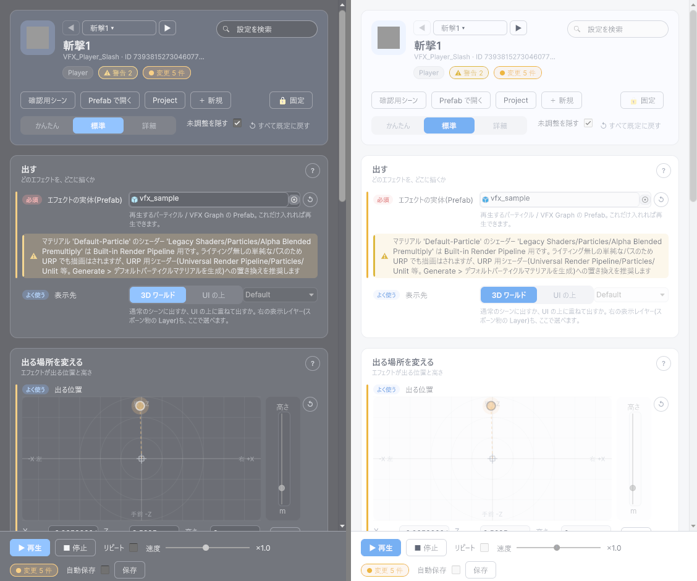
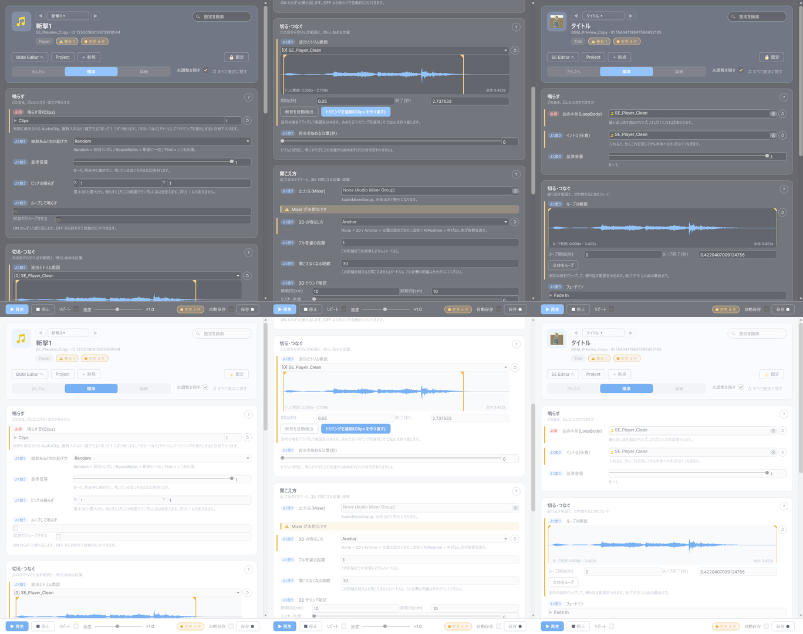
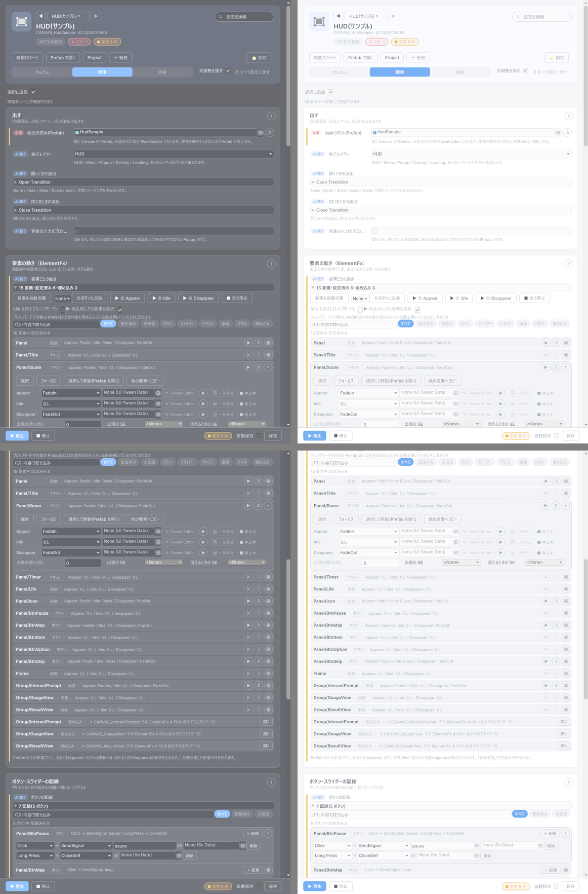
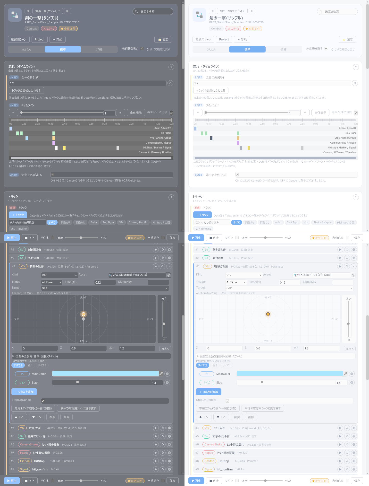
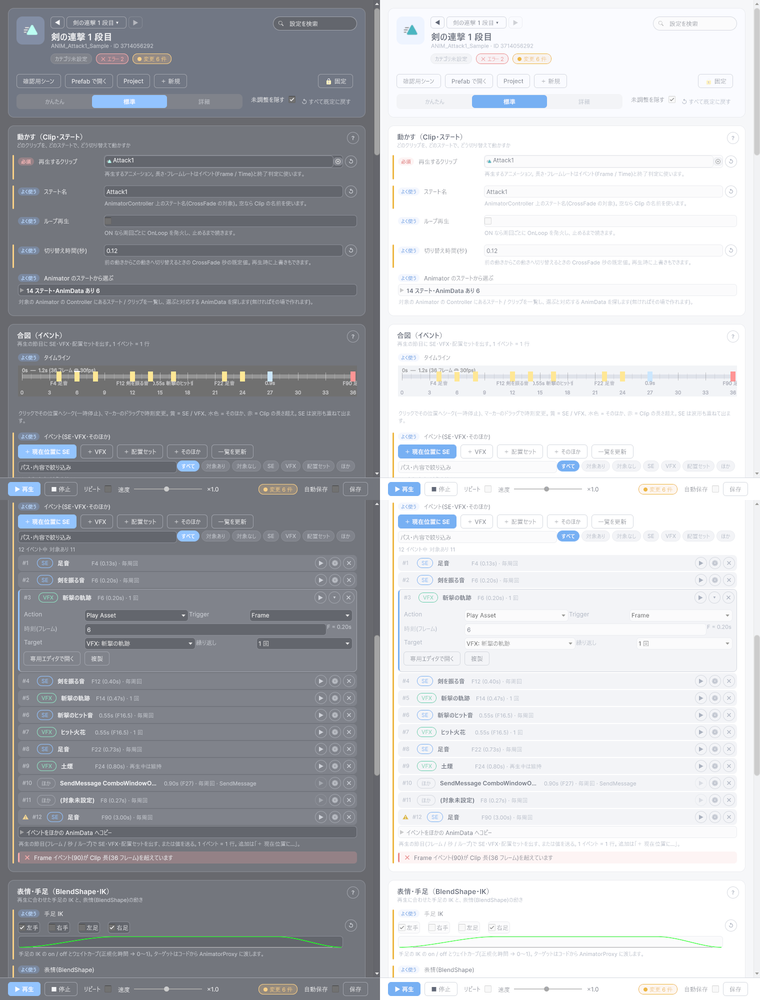
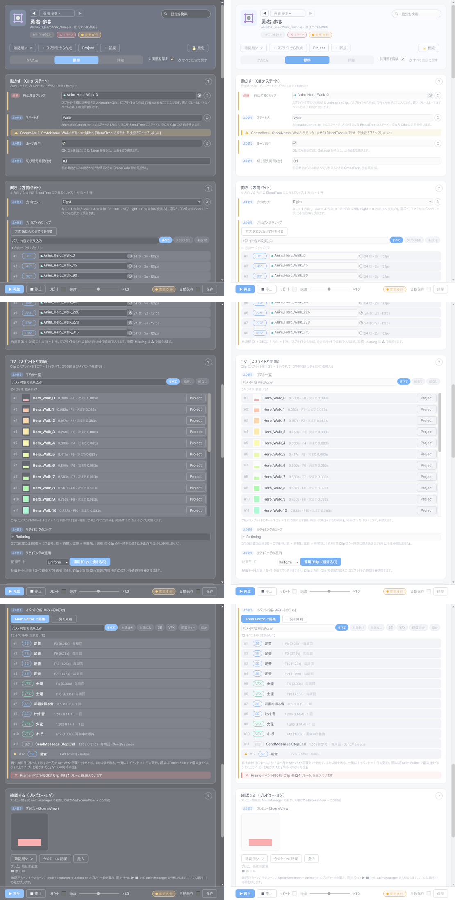
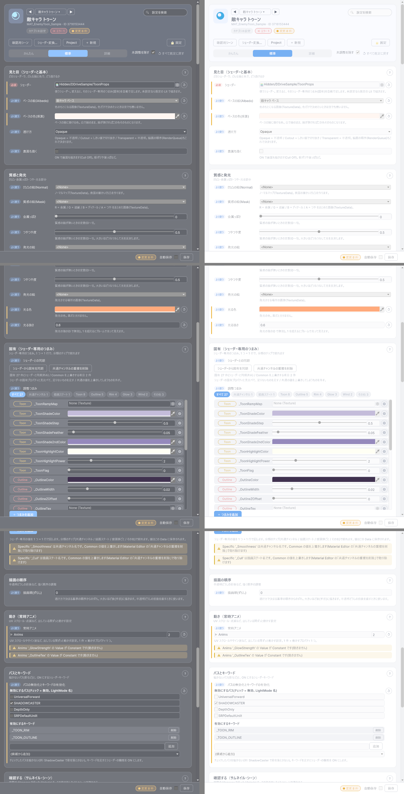

# 1010. 専用エディターの新デザイン移行（仕様書）

> 2026-10-12 起票。**ユーザー決定: サンプル E（[1008](1008_editor_ux_redesign.md) §3 E、試験版 v1.7.0-preview.3）のデザインを承認。全専用エディターをこのデザインに移行する。** 旧エディターはアーカイブして `Tools > D-Drive > Archive` から開けるようにし、新エディター間の導線（「○○ Editor で開く」等）は旧エディターを使わない。旧エディターの機能はすべて引き継ぐ（機能同等）。試験で分かったこと（保存の経路・自動保存・Data 切替・固定バー・未調整の折りたたみ・調整つまみ・速度の ×1.0 デテント）をすべて反映する。
> チケットは [1004](1004_tasks.md) の UX 節（UX-1〜UX-20）。実装は Sonnet のエージェントに委任し、1 チケット = 1 PR。設計の背景と現状調査は [1008](1008_editor_ux_redesign.md)。

## 1. 決定事項（2026-10-12）

| # | 決定 |
|---|---|
| D-1 | 新エディターの見た目・構造は **E** を正とする（ヒーロー / セグメント〔かんたん・標準・詳細〕/ 目的別カード / 検索 / 未調整の折りたたみ / 固定アクションバー / 調整つまみ / 視覚部品 / 空状態 / インライン検証）。E 固有の割り切り（VfxData のみ・Dark のみ確認）は本実装で解消する |
| D-2 | **機能同等が完了条件**。各エディターのチケットは「旧エディターの機能の棚卸し表 → 全行『あり』」を PR に含める（E でやった [1008](1008_editor_ux_redesign.md) §5 の対応表と同じ形式） |
| D-3 | **旧エディターは削除せずアーカイブ**: コードは残し、メニューだけ `Tools > D-Drive > Archive > <旧名>` に移す（`DDriveMenu.Archive` を追加）。Inspector の「〜で開く」は新エディターが `Order = 0`、旧エディターは `(旧) 〜で開く` で `Order = 100` として残す（`[DataEditor]` 対応表は**追加のみ**になる。[42](42_distribution.md) §5.9）。旧エディターへの機能追加はしない（バグ修正のみ）。削除は次の MAJOR の候補として [1001](1001_open_items.md) に載せる（実装時の補足 2026-10-12: 旧エディターの `[DataEditor]` 行はラベルと Order が変わるため、`editor-contract.txt` では『削除 1 行 + 追加 2 行』になる。§5.9 の弱い互換面として CHANGELOG に書いて許容する。以後の UX-3〜 も同じ扱い） |
| D-4 | **新エディター間の配線は新エディターだけを使う**: 「Anchor Editor で開く」「専用エディタで開く」「Prefab Editor で開く」などの `GetWindow<旧>` / `DataEditorRegistry` 経由の導線は、すべて新エディターへ向ける。旧エディター同士の既存の配線はそのまま（Archive の中で閉じる） |
| D-5 | **保存の経路**: デザイナーの編集の保存は `DDriveAssetSave.SaveDirty(target)`（版数・UpdatedAt が進む）。`SaveAllSuppressed` は機械処理（カタログ同期・新規作成直後 等）だけ。自動保存トグル（既定 OFF、EditorPrefs）・未保存のまま切替 / 閉じるときの確認・Ctrl+S でも保存できる tooltip は全エディター共通 |
| D-6 | **共通基盤はパッケージ側** `Packages/com.ddrive.core/Editor/Ux/`（asmdef は `DDrive.Editor` に含める。namespace `DDrive.Editor.Ux`）。試験版の `Editor/Prototypes/`（asmdef `DDrive.Editor.Prototypes`）は共通基盤へ移植したあと削除し、試験版タグ `v1.7.0-preview.*` も削除する（[1001](1001_open_items.md) の後始末） |
| D-7 | **互換性**: `DDrive.Foundation` / `DDrive.Runtime` の公開 API・シリアライズ形式・enum・Validator の重さに変更なし。Editor 契約（[42](42_distribution.md) §5.9、弱い互換面）の変更は「`DDriveMenu.Archive` の追加」「`[DataEditor]` 対応表の追加」「`Editors/` 配下のメニューが新エディターを指す」の 3 つで、いずれも CHANGELOG に書く。`editor-contract.txt` は追加のみで更新。**リリースは v1.8.0（MINOR）**、全エディターが揃ってから 1 回（途中の試験版は軽い経路で可） |
| D-8 | **検証**: 各チケットは Editor 専用なので EditMode green + コンパイル 0 + `ddrive_compat` 無変更 + **スクリーンショットの自己確認ループ（Dark と Light の両方、最低 2 周）** を完了条件にする。v1.8.0 のリリース時だけ run-ci 全段 |
| D-9 | マニュアル（`docs/DesignerManual/*.html`）は新エディターの機能説明に書き換える（機能のみ。「以前は〜」は書かない。[designer-manual の慣習](../CLAUDE.md)）。画像は新エディターのスクリーンショットに差し替える。旧エディターのページは `archive-*.html` に改名してトップの一覧から外す（リンクは「アーカイブ」節にまとめる） |
| D-10 | **実運用規模のサンプルデータで確認する（2026-10-12 ユーザー指示）**: Canvas・Material など要素や情報量が多い種別は、折りたたみで隠すだけでは解決にならない（旧 Canvas Editor で HUD 10 要素 + 埋め込み 3 つを開くと、要素ごとの Foldout と埋め込みの読み取り一覧が縦に延々と並んだ）。各チケットは **実際に使う形のサンプルデータ**（例: Canvas = HUD 相当〔要素 10 以上・埋め込み 3 以上・配線 5 以上・ElementFx 設定済みと未設定が混在〕、Material = Specific 20 項目以上・Pass/Keyword あり、Presentation = トラック 8 本以上、Anim = Clip 10 以上）を `Editor/Ux/Samples/` の素材か確認用データ（`Assets/GameData`、保存しない）で作り、新エディターで開いた **Dark / Light のスクリーンショットを完了条件に含める**。見通しの基準: (1) 初期表示が 1〜2 画面に収まり、どこに何があるか見出しだけで分かる、(2) 一覧は **1 要素 = 1 行**（要素名・種類のチップ・設定の要約〔「Appear: Pop / Idle: なし / Disappear: Fade」のような 1 行要約〕・▶・↺）で、行の展開は**その行だけ**、(3) 一覧の上に **絞り込み**（検索・「設定済みだけ」「未設定だけ」・種類のチップ）と **件数**（「10 要素中 設定済み 3」）、(4) 埋め込み・入れ子は読み取り一覧を展開表示せず **1 行の要約 + 「開く」**（子の中身は子のエディターで見る）、(5) 一括操作（全 Appear 等）は一覧の上に 1 行、(6) 20 行を超える一覧は `ListView`（仮想化）で描画し、ウィンドウのスクロールは一覧の外側 1 本だけ、(7) 500px 幅で崩れない。折りたたみは (1)〜(6) を満たしたうえでの補助 |

## 2. 共通基盤（`Editor/Ux/`、UX-1）

E の実装（`Editor/Prototypes/`）を種別非依存に整理して移す。クラス名は移植時に `Pd*` / `Pe*` の接頭辞を外す。

| 部品 | 元（Prototypes） | 内容・移植時の変更 |
|---|---|---|
| テーマ | `Theme/PrototypeD.uss` + `PrototypeE.uss` | `Editor/Ux/Theme/DDriveUx.uss` 1 本に統合。Light / Dark の変数（`--ux-*`）。**C# のインラインスタイル禁止**（U-27 の機械点検に「Ux 配下の `.style.` 代入禁止」の検査を足す） |
| ウィンドウ基底 | `PrototypeWindowBase` | `UxEditorWindow<TData>`（`TData : AssetDataBase`）。対象の追従 / 🔒 固定 / Data 切替 / ヒーロー / セグメント / 検索 / モード・未調整の記憶（EditorPrefs、キーは種別ごと）/ 固定バー / 保存（D-5）/ 空状態 / `[SerializeField]` での再コンパイル耐性 / Undo 同期 / 検証のインライン化。`ScrollView` + フッターの構成は U-27 を通す形に固定 |
| 欄の表 | `FieldGuide` / `FieldGuideEntry` / `VfxFieldGuide` | `FieldGuide<TData>`。欄ごとに Field / 平易なラベル / 一言説明 / 段（必須・よく使う・詳細）/ 目的カード / 検索語 / 既定値判定 / 行の種類（通常・視覚部品・つまみ・読み取り専用）。**種別ごとの表は各チケットで書く**（AssetDataBase の共通 14 欄は基底の表で共有）。段の根拠は Validator（Error にする欄 = 必須） |
| 行・カード | `PdRow` / `PdCard` / `GuidedField` / `FieldGuideUi` | `UxRow` / `UxCard`。段のバッジ、変更の色バー、↺、⚙（定義の詳細）、「？」（マニュアルの該当節。`ManualLauncher` にアンカー指定を足す）、未調整の折りたたみ、空カードの文言 |
| Data 切替 | `DataSwitcher` | ◀ [名前 ▾] ▶（検索付き AdvancedDropdown、最近 5 件、カテゴリ別）。種別非依存 |
| 固定バー | `PrototypeWindowBase.CreateFooter` | ▶ / ■ / リピート / **速度（×1.0 デテント + 値ラベル + クリックで戻す）** / 変更 N 件 / 自動保存 / 保存 ●。再生の有無は種別が決める（Tuning・Material など再生の無い種別は ▶ を出さない） |
| 視覚部品 | `DurationBar` / `AnchorPad` / `PeTunePanel` | `DurationBar`（長さ・フェード）、`AnchorPad`（位置・高さ。Vfx / Se / Presentation のトラック / Anchor で共用）、`TuneKnobs`（調整つまみ: 分類チップ・型別部品・↺・⚙・追加パレット。Vfx の Params、Material の Specific、Canvas の ElementFx パラメータ、Tuning の値で共用） |
| 検証 | `DataValidationSection` + インライン | 欄に結びつく結果は欄の下、結びつかないものは「その他の検証」。結びつけは文字列照合ではなく `ValidationResult` に欄名（`Field`）を持たせる方向で、Validator 側に**任意の**追加（既存の結果の重さ・Code は変えない） |
| スクリーンショット自己確認 | エージェントの手順 | `GUIView.GrabPixels` でウィンドウを画像化する共通ヘルパー `UxScreenshot`（Editor 専用、テスト・エージェント用）。Light / Dark の切替込み |

## 3. 移行の順序と各エディターの要点

順序は「共通基盤 → 使用頻度と欄の多さ → 残り」。各チケットの完了条件は §1 D-2 / D-8。

| 順 | チケット | 旧エディター | 要点（旧の機能のうち特に落としやすいもの） |
|---|---|---|---|
| 1 | UX-1 | — | 共通基盤（§2）。VFX を題材に E を移植して動かす |
| 2 | UX-2 | `VfxEditorWindow` | E をそのまま正式化（`VfxEditorWindow2` → 名前は `VfxEditor`）。E の対応表の全行 |
| 3 | UX-3 | `AudioEditorWindow`（Se / Bgm） | 波形・トリム・ループ点の編集（IMGUI の波形は `IMGUIContainer` で載せる）、3D サウンド確認、Mixer、`AudioPreviewPane`。AnchorPad を 3D の位置確認に |
| 4 | UX-4 | `CanvasEditorWindow`（+ ButtonWires / EmbedActive / Navigation グラフ） | 要素の自動収集、ElementFx 割当（プリセット一括・全 Appear/Idle/Disappear・プレハブモードで流す）、ボタン / スライダーの配線、埋め込み Canvas とその有効 / 無効、Navigation グラフ（`NavigationGraphView`）、FirstSelected、確認用シーン。欄が最も多いので「未調整の折りたたみ」と検索が効くこと |
| 5 | UX-5 | `PresentationEditorWindow` | トラックの一覧（タイムライン IMGUI）、Signal レーン、環境切替、統合プレビュー（確認用シーンのモデル配置）、トラックごとの Anchor / Params、Scope、ログ、SceneView の Anchor 表示、「専用エディタで開く」（→ 新エディターへ） |
| 6 | UX-6 | `AnimEditorWindow` | モデル情報、Clip / StateMachine / IK / BlendShape / イベント、イベントログ、ブレンド確認、Animator から選択、SE・VFX イベント |
| 7 | UX-7 | `Anim2DEditorWindow` + `Anim2DCreateWindow` | 作成ウィザード（B の雛形方式に置き換え可）、ウィンドウ内プレビュー（Sprite。ADR-4 の例外として現状維持） |
| 8 | UX-8 | `MaterialEditorWindow` + Convert + Thumbnail + `MaterialPassKeywordSection` | Specific を TuneKnobs に、Pass / Keyword、変換ウィンドウとサムネイルは別ウィンドウのまま（テーマだけ当てる） |
| 9 | UX-9 | `ModelEditorWindow` | 複数モデル並列表示、Material スロット（→ Material の新エディターへ）、Default Animation |
| 10 | UX-10 | `CameraFxEditorWindow`（Shake / Haptics） | プリセット 10 種、波形グラフ、`EditorHapticsPreviewDriver` |
| 11 | UX-11 | `AnchorEditorWindow` + `AnchorGroupEditorWindow` | 試し出し、既存ヒエラルキーから作る、SceneView ハンドル（`AnchorSceneHandles`）。AnchorPad を主部品に |
| 12 | UX-12 | `UiTweenEditorWindow` + `UiPresetGalleryWindow` | トラック、実要素への ▶、プリセットギャラリー（お気に入り・フィルタ・検索） |
| 13 | UX-13 | `SliderEditorWindow` / `SliderSkinEditorWindow` / `ButtonSkinEditorWindow` | プリセット 5 種、`ControlSkinPreviewSection` |
| 14 | UX-14 | `PrefabEditorWindow` | 小さいので UX-9 と同じ PR でよい |
| 15 | UX-15 | `TuningWindow`（IMGUI） | カテゴリ + 検索 + Tables タブ、Play 中の再読込通知。値は TuneKnobs。再生ボタン無し |
| 16 | UX-16 | `CutsceneDataEditor`（Inspector のみ） | ウィンドウ化はしない。Inspector のボタン列にテーマを当て、新エディターへの導線（Presentation 等）を向け直すだけ |
| 17 | UX-17 | `AssetBrowserWindow` / `NewAssetDialog` | 構造は変えず、テーマ（USS）・「開く」の向き先・空状態の文言を新エディターに合わせる |
| 18 | UX-18 | — | Archive メニュー（`DDriveMenu.Archive`）に旧エディターを並べ替え、`[DataEditor]` の `(旧)` ラベルと `Order = 100`、新エディター間の配線の総点検（`GetWindow<旧>` を grep して 0 にする。Archive 内の旧→旧は除く）、`editor-contract.txt` の更新（追加のみ）、マニュアル（D-9）、[09](09_editor_tools.md) §6/§8 の表 |
| 19 | UX-19 | — | 試験版の後始末: `Editor/Prototypes/` 削除、`vfx_sample` は `Editor/Ux/Samples/` へ移して空状態の「サンプルを作る」を全種別に（種別ごとのサンプル素材は無ければボタンを出さない）、タグ `v1.7.0-preview.*` 削除、[1001](1001_open_items.md) の行を消す |
| 20 | UX-20 | — | v1.8.0 リリース（run-ci 全段、[12](12_review.md) §7）。CHANGELOG の互換性節に D-7 の 3 点。MS2026 への案内（manifest を正式版へ） |

## 4. 各チケットの PR に必ず含めるもの

1. **機能対応表**（旧 → 新、全行「あり」。[1008](1008_editor_ux_redesign.md) §5 E の表の形式）を `docs/1010` §5 に追記
2. **`FieldGuide<TData>` の表**（全フィールド。編集不可は Id / Version / Author / UpdatedAt と `HideInInspector` だけ）
3. `[DataEditor(typeof(TData), "〜で開く")]`（新、`Order = 0`）と、旧の `"(旧) 〜で開く"`（`Order = 100`）
4. メニュー: 新は `DDriveMenu.Editors + "<名前>"`（旧と同じラベル）、旧は `DDriveMenu.Archive + "<名前>"`
5. EditMode green（U-27 機械点検・`DataEditorRegistryTests`・`EditorContractSnapshotTests`）、コンパイル 0、`ddrive_compat` 無変更
6. スクリーンショット（Dark / Light）を `docs/images/1010_<種別>.png` に、自己確認ループの記録（直した崩れ）を PR 本文に。**要素の多い種別は D-10 の実運用規模のサンプルデータで開いた画像を必須にする**（空に近いデータの画像だけでは完了にしない）
7. マニュアルの該当ページの更新（D-9）

## 5. 実装メモ（チケットごとに追記）

（UX-1 から順に、ファイル一覧・対応表・割り切った点を追記する）

**2026-10-12 追記（UX-1、共通基盤 `Editor/Ux` + 題材の `VfxEditor`）**

- **作ったファイル**（`Packages/com.ddrive.core/Editor/Ux/`、`DDrive.Editor` の中・namespace `DDrive.Editor.Ux`・全型 internal）:
  `Theme/DDriveUx.uss`（D + E の USS を 1 本に統合。変数 `--ux-*` / Painter2D 用 `--ux-p-*`、`.ux-hidden`）/ `UxEditorWindow.cs`・`.Chrome.cs`・`.Rows.cs`（`UxEditorWindow<TData>`。対象・保存・再生・定期更新 / ヒーロー・固定バー・空状態・テーマ / カード・行・検証・絞り込み・折りたたみ・一括リセット）/ `FieldGuide.cs`（`FieldTier` / `FieldRowKind` / `FieldGuideEntry` / `FieldGuide<TData>`）/ `UxRow.cs`（`UxRow` / `UxVisualRow` / `GuidedField`）/ `UxCard.cs` / `DataSwitcher.cs` / `DurationBar.cs`（`UxLifeMode` を持つ）/ `AnchorPad.cs` / `TuneKnobs.cs`（`TuneKnobs` / `TuneKnobsRow` / `ITuneSource` / `TuneCategories`）/ `UxPalette.cs` / `UxShow.cs`（`Show(bool)` と `IUxSyncable`）/ `UxScreenshot.cs`。
  Vfx 側（`Editor/Vfx/`）: `VfxEditor.cs`（`VfxEditor : UxEditorWindow<VfxData>` + `VfxSample`）/ `VfxFieldGuide.cs` / `VfxTuneSource.cs`（`ITuneSource` の実装 = Params）/ `VfxEditorRows.cs`（Render・Anchor ツール・AnchorId・LightLayer・複数同時再生・長さの入力）。他: `ValidationResult.Field` + `WithField`（Foundation、追加のみ）、`VfxDataValidator` の Prefab / Params の結果に `Field` を付与、`ManualLauncher.OpenPage(page, anchor)`、`Tests/Editor/UxFoundationTests.cs`。
- **E からの対応**（`Editor/Prototypes/` は**消していない**。UX-19 で削除）:

| E（試験版） | 共通基盤 / VfxEditor |
|---|---|
| `PrototypeWindowBase` + `PrototypeEWindow` の汎用部分 | `UxEditorWindow<TData>`（種別が決めるのは `Guide` / `PrefsKey` / `ManualPage` / `CardDescription` / `CreateRow` / 再生の 3 メソッド / 主操作列の追加 / 検証の補助語だけ） |
| `PrototypeD.uss` + `PrototypeE.uss`（`pd-*` / `pe-*`） | `DDriveUx.uss`（`ux-*` に統一。`pe-empty` は空状態の `ux-empty` と衝突するため `ux-knobs-empty`） |
| `FieldGuide` / `VfxFieldGuide` | `FieldGuide<TData>`（共通欄 8 欄 = 管理情報カードは基底が持つ）/ `VfxFieldGuide`（固有欄だけ） |
| `PdRow` / `PdCard` / `FieldGuideUi`・`GuidedField` | `UxRow` / `UxCard` / `GuidedField`（入力部品の共通ヘルパー）。A〜C 専用の `GuidedField` 本体・`FieldGuideUi.Card` は移植していない |
| `PdLifeRow` / `PdAnchorRow` | `UxVisualRow`（視覚部品を載せる汎用の行）+ `VfxLifeInput`（DurationBar + 数値） |
| `PdRenderRow` / `PeAnchorToolsRow` / `PeAnchorIdRow` / `PeLightLayerRow` / `PeSlotsRow` | `VfxRenderRow` / `VfxAnchorToolsRow` / `VfxAnchorIdRow` / `VfxLightLayerRow` / `VfxSlotsRow`（Vfx 固有） |
| `PeTunePanel` / `PeTuneRow` / `PeProps` | `TuneKnobs` / `TuneKnobsRow`（種別非依存）+ `VfxTuneSource`（候補の列挙 = 材質のシェーダープロパティ）。分類語は `TuneCategories` |
| `DataSwitcher`（VfxData 専用） | `DataSwitcher`（Data の型名で一覧を引く。最近の鍵も型ごと） |
| `PdPalette` | `UxPalette` |
| 固定バー・保存・自動保存・未保存の確認・速度のデテント | 基底に移植。再生の有無は `SupportsPlayback`（false の種別は ▶ ■ リピート 速度を出さない） |
| `VfxAnchorSceneGui`（既存の public static） | そのまま使う |
| `SampleVfx` | `VfxSample`（空状態の「サンプルを作る」は `HasSample` / `CreateSample` を持つ種別だけ） |

- **E からの変更点**: ①インラインスタイルを全廃（表示 / 非表示は `.ux-hidden`、薄表示は `.ux-faded`、折り返しは `.ux-note`）。速度の ×1.0 の目盛りは `style.left` の割合指定をやめ、Painter2D の重ね要素（色は USS から）で描く ②モード（かんたん・標準・詳細）は `[SerializeField]` から EditorPrefs（種別ごとの鍵 `DDrive.Ux.<PrefsKey>.Mode`）へ。「未調整を隠す」「自動保存」も同じ鍵の規則 ③検証は `ValidationResult.Field` で欄に結びつけるのを最優先にし、`Field` の無い結果だけ従来のメッセージ照合（`ValidationTokens`）で救済 ④Undo のあとの再描画を 1 本に統合（E は 2 つの購読が別々に走っていた）⑤`DataSwitcher` の同カテゴリ一覧を 2 秒キャッシュ（150ms ごとの全走査をやめた）⑥アセットとして保存されていない Data（メモリ上）では未保存の確認を出さない（テストでダイアログが残る事故の防止）⑦試験版の注意書き（「試験版: 確認後に削除予定」）を外した ⑧`DurationBar` の LifeMode は種別非依存の `UxLifeMode`（Vfx は `VfxEditor` で対応づけ）⑨`Open(VfxData, GameObject)`（Presentation 等から「一緒に調整」で開く入口）も旧エディターと同じ形で持たせた。
- **`ValidationResult.Field`**: `public readonly string Field`（既定 null）と `WithField(string)`。公開 API の追加のみ（`public-api-DDrive.Foundation.txt` に 2 行増加 = MINOR。更新後 `ddrive_compat` は `changed:[]`）。既存のコンストラクタ・`Code` / `Severity` / `Message` / `FixAction`・Validator の結果の重さは変えていない。付けたのは `VfxDataValidator` の Prefab 未設定と Params の TargetProperty 不一致だけ（他の Validator は UX-2 以降の各チケットで必要になったときに足す。付いていない結果は従来どおり照合 / 「その他の検証」）。
- **確認**: コンパイル 0、EditMode 2085/2085 green（`UxFoundationTests` = U-27 の機械点検に足した「Editor/Ux に `.style.` 代入が無い」「C# が付ける `ux-*` クラスが USS に定義されている」と、「`VfxFieldGuide` が VfxData の編集できる全フィールドを持つ」「管理情報の既定」「`ValidationResult.Field`」「`VfxEditor` がヒーロー・固定バー・カード 8 枚を組む」を含む）、`ddrive_compat` は `ValidationResult.Field` の 2 行だけ → 更新後 `changed:[]`、`ddrive_forbidden_api` 違反 0。
  スクリーンショットは `UxScreenshot`（`GUIView.GrabPixels`）で Dark / Light の両方（上の画像）。自己確認ループ（2 周）で直したこと: 1 周目 = `GrabPixels` の矩形がホストビュー（タブ見出し込み）の左下原点で、内容の下 26px が切れて上下も逆さだった（撮り方を直した）。E と新 VfxEditor を同じモード・同じ位置で並べて、ヒーロー・出す・出る場所を変える（AnchorPad・基準・Anchor アセット）・長さ（DurationBar）・つまみ・複数同時再生・管理情報・固定バーのすべてが同じであることを確認。2 周目 = 空状態（Dark / Light）の「サンプルを作る」がピッカーに貼り付いていたので余白を足した、幅 500px（最小幅）でヒーロー・固定バー・各カードが切れず折り返すこと、速度スライダーの ×1.0 の目盛りが新方式でも出ること、Params の調整つまみ（分類チップ・型別部品・TargetProperty 不一致が Params 欄の下に結びつく）を確認。機能の動作確認は `execute_code` で、再生 / 停止、検証の欄結びつけ（Prefab 未設定 → 「エフェクトの実体(Prefab)」の下、Flags → 動作の取り決め、スキーマ → その他の検証）。
- **割り切り**: ①`Editor/Ux` の型は internal（`InternalsVisibleTo` を置かない方針のため、テストはリフレクション）②`ManualAnchor`（カードの「？」を節に飛ばす）は仕組みだけで、Vfx のマニュアルにまだ節の id が無いので null（ページの先頭が開く）③`FieldRowKind.ReadOnly` と `FieldGuideEntry.DefaultCheck` は共通基盤に用意したが Vfx は使っていない（Id / Version / Author / UpdatedAt は E と同じく管理情報カードの 1 行表示）④PlayMode は実行していない（Editor 専用 + Foundation の追加のみ。[12](12_review.md) §7 の軽い経路に準ずる）⑤`UxScreenshot.SwitchTheme` は `InternalEditorUtility.SwitchSkinAndRepaintAllViews`（ユーザーの Unity の配色設定を一時的に切り替える。撮影後に元へ戻す運用）⑥`vfx_sample.prefab` は `Editor/Prototypes/Samples/` のまま（`VfxSample` は `/Samples/vfx_sample.prefab` で探すので UX-19 で移しても動く）。
- **UX-2 に残したこと**: ①`VfxEditorWindow` の `[DataEditor]` を `(旧) VFX Editor で開く`（Order 100）に変え、新 `VfxEditor` に `[DataEditor(typeof(VfxData), "VFX Editor で開く")]`（Order 0）を付ける ②メニュー: 新 `Tools > D-Drive > Editors > VFX Editor`（今は仮の `VFX Editor (新)`）、旧は `DDriveMenu.Archive`（UX-18 で定数を足す）③`VfxEditorWindow.Open(...)` の呼び出し元（Presentation の「一緒に調整」ほか）を新エディターへ向ける ④マニュアル（`vfx-editor.html`）の書き換えと、あれば節の id を足して `ManualAnchor` を使う ⑤機能対応表（旧 `VfxEditorWindow` → `VfxEditor` の全行「あり」。試験版 E の対応表 [1008](1008_editor_ux_redesign.md) §5 と同じ行で、UX-1 時点で E と同じ画面が出ることまでは確認済み）を UX-2 の節に載せる ⑥`docs/images/1010_vfx.png` は UX-2 で撮り直してよい。

**2026-10-12 追記（UX-2、VFX の新エディターの正式化）**

- **やったこと**: ①`DDriveMenu.Archive`（`Tools/D-Drive/Archive/`）を追加（UX-18 の前倒し、追加のみ）②新 `VfxEditor` に `[DataEditor(typeof(VfxData), "VFX Editor で開く")]`（Order 0）とメニュー `Tools > D-Drive > Editors > VFX Editor`（旧と同じラベル）。旧 `VfxEditorWindow` は `[DataEditor(…, "(旧) VFX Editor で開く", Order = 100)]` とメニュー `Tools > D-Drive > Archive > VFX Editor`、ウィンドウの題は `(旧) VFX Editor` ③`VfxEditorWindow.Open(...)` の呼び出し元を向け直し ④マニュアル `vfx-editor.html` を新エディターの説明に書き換え（節に id: `show` / `place`（`anchor`）/ `life` / `look` / `link` / `multi` / `admin` / `validation` / `prefab-mode` / `header` / `play`。各カードの「?」は `VfxEditor.ManualAnchor` で該当節へ飛ぶ）、旧の説明は `archive-vfx-editor.html`（画像も `archive-vfx-editor-*.png`）、`Readme.html` に「アーカイブ」節 ⑤`Tools/SpecWeb/tools/build-manual.js` を再生成（`push.cmd` / clasp push はしていない）。
- **向け直した呼び出し元**（`grep -rn VfxEditorWindow Packages/com.ddrive.core/Editor`）: `PresentationEditorWindow.TrackEditors.cs`（トラックの「専用エディタで開く」「一緒に調整」= `VfxEditor.Open(data, attach)`）の 1 か所だけが旧を直接呼んでいた。Inspector の「エディターで開く」・AssetBrowser のダブルクリック・Anim の SE / VFX イベント・NewAsset 導線などは `DataEditorRegistry`（`TryGetPrimary` = Order 最小）経由なので、`[DataEditor]` の付け替えで自動的に新へ向く。試験版 `PrototypeBWindow` の「すべての設定を見る」は `DDrive.Editor.Prototypes` から internal の `VfxEditor` が見えないので `DataEditorRegistry.OpenDefault(Target)` にした（UX-19 で削除）。旧 `VfxEditorWindow` 自身の内部参照はそのまま（旧→旧）。残る `VfxEditorWindow` の文字列はコメント・`VfxAnchorSceneGui`（旧 / 新 / 試験版の共通部品）だけ。
- **テスト**: `DataEditorRegistryTests`（新を第 1 候補、旧は第 2 候補として登録されていること）・`AssetBrowserDoubleClickTests`（既定の向き先 = 新、`OpenDefault` で新が開き `Target` が入る）・`NewAssetToolbarButtonTests`（TearDown に新を追加。`GetDataTypes(旧)` は旧のまま）。新 `VfxEditor` は internal なのでテストからは型名（`DDrive.Editor.Vfx.VfxEditor`）で引く。
- **機能対応表（旧 `VfxEditorWindow` → 新 `VfxEditor`、全行あり）**: [1008](1008_editor_ux_redesign.md) §5 の UX-0f の表を元に、旧の UI 要素（`VfxEditorWindow*.cs` の `Button` / `Toggle` / `Foldout` / `AddBoundProperty`）を 1 行ずつ、新エディターを詳細モードで開いたときの全ラベルの一覧（`execute_code` で UIElements を走査）と突き合わせた。

| 旧 VfxEditorWindow の機能 | 新 VfxEditor の場所 | 状態 |
|---|---|---|
| ツールバー「🔒 対象を固定」 | ヒーローの「固定」 | あり |
| ツールバー「確認用シーンを開く」 | ヒーローの「確認用シーン」 | あり |
| ツールバー「Prefab を開く」（プレハブモード） | ヒーローの「Prefab で開く」 | あり |
| ツールバー「Project で表示」 | ヒーローの「Project」・アイコンのクリック | あり |
| 「＋ 新規作成」 | ヒーローの「＋ 新規」 | あり |
| 対象アセット欄 | ◀ [名前 ▾] ▶ と空状態のピッカー・ドロップ・最近のデータ | あり |
| スポーン先（シーン内オブジェクト） | 「出る場所を変える」カードの「出る場所の基準」 | あり |
| ▶ 再生 / ■ 停止 / 再生中のやり直し | 固定バーの「▶ 再生（再生中は ▶ やり直し）/ ■ 停止」 | あり |
| リピート | 固定バーの「リピート」 | あり |
| 速度（0.1〜2） | 固定バーの「速度」（×1.0 クリックで等倍） | あり |
| ステータス（● 再生中 / ■ 停止中） | ▶ ボタンの文言と ■ の状態 | あり |
| 一時停止（旧マニュアルに記述はあったが旧エディターの UI には無かった） | — （旧にも無いので対象外。新マニュアルからは記述を外した） | 対象外 |
| 基本設定: Prefab | 「出す」カードの「エフェクトの実体（Prefab）」 | あり |
| 基本設定: 寿命モード / 継続秒数 / 停止時フェード秒 | 「長さ・消え方を変える」カードの DurationBar と数値 | あり |
| 基本設定: 描画モード（Render）/ RenderLayer | 「出す」カードの「表示先」と表示レイヤー | あり |
| 基本設定: LightLayerMask | 「出す」カード（詳細）の「ライトの当たり方」 | あり |
| 基本設定: 共通フラグ（Pool / Pause / Net） | 「長さ・消え方を変える」カード（詳細）の「動作の取り決め」 | あり |
| Anchor: Anchor アセット（AnchorId） | 「共通の出る位置（Anchor アセット）」（詳細） | あり |
| Anchor: Anchor Editor で開く / 埋め込みをアセット化 | 同欄の下の 2 ボタン | あり |
| Anchor: Space / Path / 高さ / 向き / スケール | AnchorPad + 詳細の「位置の全設定」 | あり |
| Anchor: Path を一覧から選ぶ（★ AnchorPoint）・解決の表示 | 「出る場所の基準」の「Path を一覧から選ぶ」・解決の文 | あり |
| Anchor: 2D パッド | AnchorPad（パッド + 高さスライダー + 数値 + 原点へ） | あり |
| Anchor: 回転追従 / 親消滅後も残す | 詳細の「位置の全設定」の Follow Rotation / Detach On Stop | あり |
| Anchor: SceneView 表示（移動・回転ハンドル、Anchor アセット編集、描画権の案内） | 「出る場所の基準」の「SceneView に表示」と案内文（描画は共通の `VfxAnchorSceneGui.Draw`） | あり |
| パラメータ（再生中は即時反映） | 「見た目を調整する（Params）」の調整つまみ | あり |
| パラメータ: 定義の追加・削除（Label / Type / TargetProperty / Anim） | 「＋ つまみを追加」・行の「⚙」・自由入力 | あり |
| イベント（OnSpawn / OnLoop / OnDestroy） | 「音・イベントと合わせる」カード（詳細） | あり |
| 複数同時再生（最大 8 スロット、▶ / ■） | 「複数同時再生」カード（詳細） | あり |
| 検証（Error / Warning） | 欄の下のインライン表示・「その他の検証」・ヒーローの警告チップ | あり |
| カメラ / ライトが無い警告・プレハブモード中の案内 | ヒーロー直下の HelpBox | あり |
| プレハブモードの開閉・保存で再生中の実体を撮り直す | `PrefabStage` 購読（再生中の実体の撮り直し） | あり |
| シーン切替でプレビューを止める | `activeSceneChangedInEditMode` 購読 | あり |
| Undo / Redo の同期 | `OnUndoRedo`（再描画 + 検証 + Anchor 反映） | あり |
| 再コンパイル / PlayMode 遷移に耐える状態 | 対象・固定・リピート・速度・スポーン先・SceneView 表示を `[SerializeField]` | あり |
| `Open(VfxData, GameObject attachTarget)`（Presentation の「一緒に調整」） | 同じシグネチャで持つ（`execute_code` で attach が入ることを確認） | あり |

  新エディターで増えたもの（旧に無い、欄の整理に伴うもの）: かんたん / 標準 / 詳細の 3 モード・設定の検索・未調整の折りたたみ・すべて既定に戻す・保存ボタンと自動保存・カードの「?」からマニュアルの節へ。
- **確認**: コンパイル 0。`execute_code`: `DataEditorRegistry.GetEntries(VfxData)` = [`VfxEditor` "VFX Editor で開く" 0, `VfxEditorWindow` "(旧) VFX Editor で開く" 100]、`OpenDefault` で新が 1 つだけ開く・`entries[1].Open` で旧（題 `(旧) VFX Editor`）が開く、Presentation の「一緒に調整」相当の `VfxEditor.Open(data, go)` で `_attachTarget` が入り旧は開かない、`StartPlayback` / `StopPlayback` で再生・停止、メニュー `Tools/D-Drive/Editors/VFX Editor` と `Tools/D-Drive/Archive/VFX Editor` が有効。スクリーンショットは Dark / Light（標準モード、`UxScreenshot`）。自己確認 2 周: 1 周目で Dark の撮影がモード切替前の状態（詳細）で撮れていたので撮り直し、2 周目で両テーマとも標準モードのヒーロー・カード・固定バーが切れていないことを確認（Light のパッドの罫線が薄いのは UX-1 から同じで、承認された E のデザインのまま）。
- **互換性（editor-contract.txt）**: 追加 3 行（`Archive = Tools/D-Drive/Archive/`、`VfxData -> VfxEditor "VFX Editor で開く" order=0`、`VfxData -> VfxEditorWindow "(旧) VFX Editor で開く" order=100`）と**削除 1 行**（旧 `VfxData -> VfxEditorWindow "VFX Editor で開く" order=0`）。削除行は「旧エディターのラベルと Order が変わる」ことの機械的な帰結で、追加だけでは避けられない（新エディターが旧ラベルを引き継ぐ形でも、旧の行は変わる）。Editor 契約は弱い互換面（[42](42_distribution.md) §5.9）で、1010 §3 の方針（旧は `(旧)` Order 100）どおりだが、`ddrive_compat` が removed を出すため、スナップショット更新はユーザー承認待ち。

**2026-10-12 追記（UX-3、Audio〔Se / Bgm〕の新エディター）**

- **構成**: `UxEditorWindow<TData>` の `TData` は具体型（基底が `CreateInstance<TData>()` で既定値の複製を作る）なので、抽象の `AssetDataBase` 基底の 1 ウィンドウにはせず、**`SeEditor : UxEditorWindow<SeData>` と `BgmEditor : UxEditorWindow<BgmData>` の 2 ウィンドウ**にした。`DataEditorRegistry`（Inspector の「Audio Editor で開く」・Asset Browser のダブルクリック）が種別に応じた方を開く。**Se ⇄ Bgm の行き来**はヒーローの「BGM Editor へ / SE Editor へ」（元のウィンドウの隣にもう片方を開き、選択中の Data か最近開いた Data を入れる。`SwitchFrom`）。メニュー `Tools > D-Drive > Editors > Audio Editor` は BGM を選んでいれば BgmEditor、それ以外は SeEditor を開く。
- **ファイル**（`Editor/Audio/`、すべて internal）: `SeEditor.cs` / `BgmEditor.cs`（土台への指定・再生・欄の組み立て）/ `SeFieldGuide.cs` / `BgmFieldGuide.cs`（欄の表）/ `AudioWaveformView.cs`（`AudioWaveSpec` + 波形の列データ `WavePeaks` + Painter2D の波形。端のドラッグ・範囲外クリックで近い端を移動・ホバー線・再生位置・再生開始位置の目印）/ `AudioListenerPad.cs`（3D サウンド確認パッド）/ `AudioEditorParts.cs`（`SeTrimInput` = Source 選択 + 波形 + 開始 / 終了の数値 + 無音検出 + トリミング適用、`BgmLoopInput` = ループ範囲、`SeStartOffsetInput`、`SeLoopRow`、`SeAnchorIdRow`）。他: `UxEditorWindow<TData>.SupportsSpeed`（固定バーの速度を出さない種別用。BGM は false）、`DDriveUx.uss` に `ux-wave*` / `ux-trim*` / `ux-lpad*` / `ux-offset*`、`SeDataValidator` / `BgmDataValidator` の結果に `.WithField(...)`（メッセージ・Code・重さは不変）、`Tests/Editor/AudioEditorTests.cs`。旧 `AudioEditorWindow` は `(旧) Audio Editor で開く(…)` Order 100 + メニュー `Archive/Audio Editor`（題 `(旧) Audio Editor`）。
- **目的別カード**（段の根拠は Validator。SE = Error は Clips のみ → 必須）: SE =「鳴らす」（Clips〔必須〕/ SelectMode / Volume / PitchRange / Loop + 試聴だけループ）・「切る・つなぐ」（波形とトリム範囲 = Sources、再生を始める位置 = StartOffsetSec）・「聞こえ方」（Mixer / Spatial / 距離 2 欄 / 共通の位置 AnchorId / 鳴る位置 Anchor〔AnchorPad〕/ Rolloff / Spread / Doppler + 3D サウンド確認パッド）・「同時再生・連打」（MaxConcurrent / CooldownSec / Flags）・「音・イベントと合わせる」（Events）・管理情報。BGM =「鳴らす」（LoopBody〔必須〕/ Intro / Volume / Flags）・「切る・つなぐ」（ループの範囲 = LoopStartSec + LoopEndSec、FadeIn / FadeOut）・「聞こえ方」（Mixer）・「拍に合わせる」（Bpm）・「音・イベントと合わせる」・管理情報。カードの「?」は `audio-editor.html` の節 id（`se-play` / `se-cut` / `se-hear` / `se-limit` / `bgm-play` / `bgm-loop` / `bgm-hear` / `bgm-beat` / `link` / `admin`）へ飛ぶ。
- **機能対応表（旧 `AudioEditorWindow` + Inspector の `SeDataEditor` → 新 `SeEditor` / `BgmEditor`、全行あり）**: 旧 `AudioEditorWindow.cs` の UI 要素（ツールバー・`ObjectField`・`DropdownField`・`IMGUIContainer` 2 つ・`Button`・`Toggle`・`Slider` 3 つ・`FloatField` 2 つ・検証セクション）を 1 行ずつ、新エディターの詳細モードの全ラベルと突き合わせた。

| 旧の機能 | 新の場所 | 状態 |
|---|---|---|
| ツールバー「＋ 新規作成」（SE / BGM の選択） | ヒーローの「＋ 新規」（各ウィンドウの種別。SE ⇄ BGM はヒーローの切替ボタン） | あり |
| 「対象アセット」ObjectField（SE / BGM） | ◀ [名前 ▾] ▶、空状態のピッカー・ドロップ・最近のデータ。Project の選択に追従、🔒 固定 | あり |
| Mixer の表示（「Mixer: 名前 / 未割当 — Validation Warning」） | 「聞こえ方」の「出力先（Mixer）」欄 + 未割当の警告が欄の下に出る（BGM も同じ） | あり |
| 編集対象 Source のプルダウン（SE） | 「波形とトリム範囲」のプルダウン（Sources が空のときは Clips[0] の波形を表示するだけ） | あり |
| 波形（IMGUI。範囲の外側を暗く、開始 = 水色・終了 = 紫、「トリム範囲 / ループ範囲: a – b / 全体」） | `AudioWaveformView`（Painter2D。範囲の外を薄く、両端は旗付きの線、左下に範囲・右下に全体の長さ。波形が読めないクリップは理由を表示） | あり |
| 端のドラッグ / 範囲外クリックで近い端を移動 / 最小幅 0.001s | 同じ操作（`PointerCapture`。1 回のドラッグ = 1 回の Undo にまとめる） | あり |
| 無音自動検出（SE） | 「無音を自動検出」ボタン（読めないクリップは警告ログ） | あり |
| トリミングを適用（Clips 再生成） | 「トリミングを適用（Clips を作り直す）」ボタン（`SeTrimApplier.Apply`） | あり |
| ▶ 再生 / ■ 停止（実 AudioManager / BgmManager 経由、SelectMode どおり） | 固定バーの ▶ / ■（再生中は「▶ やり直し」）。`PreviewService` を窓ごとに持つ | あり |
| ループ試聴 トグル（アセットは変えない） | 「鳴らす」カードの「試聴だけループさせる」（SE。BGM は元から常にループ） | あり |
| 音量スライダー（試聴用、再生中に即時反映） | 「基準音量」欄（再生中に動かすと鳴っている音へ即時反映）。**アセットの値を直接編集する形に変更**（旧は試聴専用で保存されなかった。Undo できる） | あり（変更点あり） |
| ピッチスライダー（試聴用、再生中に即時反映、0.1〜2） | 固定バーの「速度」（再生ピッチ、0.1〜2、×1.0 のデテント、再生中に即時反映。データに保存されない）。保存したい揺らぎは「ピッチの揺らぎ」欄 | あり |
| 再生開始位置スライダー（SE、0〜Clips[0] の長さ） | 「再生を始める位置」のスライダー + 数値（波形に点線の目印） | あり |
| 3D サウンド確認パッド（リスナーのドラッグ・横 / 縦範囲 ±m・リスナー角度・Min / Max の円・距離 / 角度 / 位置の表示・音源は中央） | `AudioListenerPad`（Painter2D。同じ計算 `ListenerPadMath`）。再生中の音源をリスナーから見た相対位置へ即時移動 | あり |
| パッド無効時（BGM / Spatial = None / Clips 未設定）の暗転と理由 | パッドの上に「⚠ 3D プレビュー無効」と理由（BGM はそもそもパッドを持たない） | あり |
| 検証セクション（`DataValidationSection`） | 欄の下のインライン表示（Validator の結果に欄名を付与）・「その他の検証」・ヒーローの警告チップ | あり |
| 再コンパイル / PlayMode 遷移に耐える対象 | `[SerializeField]`（対象・固定・リピート・速度・試聴だけループ） | あり |
| `AudioEditorWindow.Open(AssetDataBase)`（他エディターから） | `SeEditor.Open(SeData)` / `BgmEditor.Open(BgmData)`（`DataEditorRegistry` が呼ぶ。呼び出し元はいずれも登録表経由だった） | あり |
| Inspector（`SeDataEditor`）の Sources 一覧・無音検出・適用・「AnchorEditor で開く」・「埋め込み Anchor をアセット化」 | 「元の音とトリム範囲（一覧）」・波形の各ボタン・「共通の位置（Anchor）」の 2 ボタン（Inspector 側はそのまま残る） | あり |
| `AudioPreviewPane`（▶ ■ ループ 速度のバー。旧 AudioEditorWindow 自身は使っておらず、Asset Browser 下部のバー） | 固定バーの ▶ ■ リピート 速度が同じ役割（Asset Browser 側は変更なし） | あり |

  新エディターで増えたもの: かんたん / 標準 / 詳細・検索・未調整の折りたたみ・変更の色バーと ↺・保存と自動保存・カードの「?」・再生位置の表示（SE の Clips が 1 つのとき）・Anchor の位置パッド / AnchorId の導線・MaxConcurrent / CooldownSec / Rolloff / Spread / Doppler / Pitch Range / Select Mode / Loop / Intro / FadeIn / FadeOut / Bpm / Events / Flags（旧はウィンドウに無く Inspector だけだった欄）。
- **割り切り**: ①**再生位置のシーク（クリックでその位置から鳴らす）は作っていない**（旧にも無く、`AudioManager` にシークの API が無い。追加すると Runtime の公開 API の追加になるため本チケットでは見送り）。代わりに、SE の Clips が 1 つのときは再生位置を波形に白線で出す。BGM の再生位置は `BgmManager` が時刻を公開していないので出さない ②BGM の固定バーには速度を出さない（旧も BGM に速度は無かった。`SupportsSpeed`）③SE の波形は Source（元の音）のもの。Clips にトリム済みの音が入っているときの再生位置は、先頭の Source のトリム開始を足して合わせる（Clips / Sources が複数のときは出さない）④`AudioClip` の波形は `GetData` が読めるクリップだけ（圧縮 / ストリーミングは旧と同じく読めず、理由を表示）⑤旧の「音量 / ピッチ」の試聴専用スライダーは、上の対応表のとおり音量はアセットの値の直接編集、ピッチは固定バーの速度に置き換えた ⑥`ListenerPadMath` は旧と共用（変更なし）。
- **互換性（editor-contract.txt）**: 追加 4 行（`BgmData -> BgmEditor "Audio Editor で開く(波形・ループ編集)" order=0` / `SeData -> SeEditor "Audio Editor で開く(波形・トリム編集)" order=0` / 旧 2 行の `(旧)` `order=100`）と**削除 2 行**（旧 `AudioEditorWindow` の Order 0 の 2 行）。UX-2 と同じ扱い（旧エディターのラベルと Order が変わることの機械的な帰結）。更新前に red だったのは `EditorContractSnapshotTests.MatchesGolden` と `DDriveCompatToolTests.Compat_RealSnapshots_HaveNoDifference` の 2 件だけで、`ddrive_compat_update` のあと `changed:[]`。CHANGELOG の互換性節に追記済み。
- **確認**: コンパイル 0。EditMode 2093/2093 green（`AudioEditorTests` 8 件 = 欄の表が SeData / BgmData の編集できる全フィールドを持つ・必須の段 = Validator が Error にする欄・Validator の結果が欄に結びつく・`WavePeaks`・両エディターがヒーロー / 固定バー / カード / 波形を組む〔BGM は速度なし〕。`DataEditorRegistryTests` / `UxFoundationTests` / `DDriveDependencyToolTests.EditorOpen_OpensSeEditorForSe` は新エディターに追従）。更新前に red だったのは契約の 2 件だけ、`ddrive_compat_update` のあと `changed:[]`。PlayMode は実行していない（Editor 専用 + Validator の `WithField` 付与のみで Runtime の挙動は不変。[12](12_review.md) §7 の軽い経路に準ずる）。`execute_code`: Inspector の登録表（SeData / BgmData とも新が Order 0・旧が `(旧)` Order 100）、SE の再生 / 停止、波形のドラッグ（`PointerCapture` のイベントを送って End が動き、Undo 1 回で戻る）、開始値の変更と Undo、3D パッドのドラッグで再生中の音源が相対位置へ移動、BGM の再生 / 停止、`SwitchFrom` で SE → BGM、メニュー `Editors/Audio Editor` と `Archive/Audio Editor`。スクリーンショットは Dark / Light（標準モード、`UxScreenshot`）。自己確認 2 周: 1 周目 = 3D パッドの Max 距離の楕円がパッドの外へはみ出して他の欄の上に線が出た（Painter2D は要素の外へも描くので `overflow: hidden`）・リスナー角度のスライダーのラベルが行の入力の直下だと隠れた（1 段包む）・「試聴だけループ」のトグルのラベルが同じ理由で隠れ、`flex-basis` の流用で縦に大きく伸びた・1 つしかない Source のプルダウンが無効に見えた。2 周目 = 幅 500px（最小幅）で波形・数値欄・ボタン・固定バーが切れず折り返すこと、Light で波形・旗・パッドの色が読めること、BGM のループ範囲の波形と数値欄を確認。実データ（`Assets/GameData`）は複製を開いて操作し、保存していない。

**2026-10-12 追記（UX-4、Canvas の新エディター。D-10 対応）**

- **使ったサンプルデータ（D-10）**: このリポジトリの `Assets/GameData` に HUD（HudInteractPrompt 等）は無い（MS2026 側にある）ので、**HUD 相当を作るヘルパー `Editor/Ux/Samples/CanvasSample.cs`**（internal。`Build(folder)`）を同梱した。親 Prefab `HudSample`（要素 15 = Panel・Frame・Title / Score / Timer / Life / Icon・UiButton 5 つ・埋め込み 3 つのルートと中身）+ 子 Prefab 3 つ（InteractPrompt / GaugeView / ResultView。それぞれ Label / BtnOk / Icon）+ CanvasData 4 つ（親 + 子 3）。親は **ElementFx 15 行（設定済み 6・未設定 9 の混在。Appear / Idle / Disappear の組み合わせあり）・埋め込み 3（うち 1 つは無効で始める）・ボタン配線 7 本（5 ボタン。Click → SendSignal ×5、LongPress → CloseSelf、DoubleClick → ToggleEmbedded）・Navigation 8 要素 / リンク 14 本・FirstSelected**。呼び出し側が一時フォルダ（`Assets/…Tmp`）に作って使い終わったら消す（`Assets/GameData` には作らず、Addressables にも登録しない）。スクリーンショット（上の画像）とテスト（`CanvasEditorUxTests`）はこのサンプルで開く。20 行超の確認はこのサンプルに要素 12 行を足して行う。
- **D-10 の基準をどう満たしたか**（(1)〜(7)）:
  (1) **初期表示が 1〜2 画面に収まる**: 一覧の 4 欄（要素の動き・配線・埋め込み・Navigation）は `Foldout` で既定は閉じ（構造体・配列の欄が作る Foldout も組み終えたあとに閉じる。テスト `SampleHud_AllFoldoutsAreClosedByDefault`）、見出しだけで「15 要素・設定済み 6・埋め込み 3」「7 配線（5 ボタン）」「8 要素・リンク 14 本・最初 = Panel/BtnPause」と中身が分かる。標準モードの初期表示は 1 画面強（出す → 要素の動き → 配線 → 埋め込み → カーソル移動 → 管理情報）。
  (2) **一覧は 1 要素 = 1 行**: ElementFx = 「要素名・種類のチップ（ボタン / スライダー / テキスト / 画像 / パネル）・『Appear: PopIn / Idle: Pulse / Disappear: FadeOut』・▶・↺・⚙」、配線 = 「ボタンのパス・『Click → SendSignal 'pause' / LongPress → CloseSelf』・＋ 配線・⚙」、埋め込み = 「RootPath・有効 / 無効のチップ・→ 子の名前・開く・⚙」。展開（⚙）は**その行だけ**（ElementFx は 3 つの動きの選び方・UiTweenData 直接指定・✎・▶ ⏸ ■・出現の遅れ・SE・選択・コピー、配線は配線 1 本 = 1 行、埋め込みは RootPath・子・無効で始める・作業用の表示切替・削除）。展開のドロップダウン類は展開した行でだけ作る（15 行 × 3 つを最初から作らない）。
  (3) **絞り込みと件数**: 一覧の上に検索（パス・要約）・「すべて / 設定済み / 未設定」・種類のチップ（ElementFx）と、「15 要素中 設定済み 6（表示 n）」。ウィンドウの検索ボックスも、要素・ボタン・埋め込みのパスに一致する一覧を開いて絞る（一致が 0 件なら絞らない = 表の語だけに一致した検索で一覧が空にならない）。
  (4) **埋め込みは要約 + 「開く」**: ElementFx / 配線の一覧とも、埋め込みの子の中身（子の ElementFx・配線）は展開しない。子ごとに 1 行（「Group/InteractPrompt → CANVAS_InteractPrompt: 子の ElementFx 4 行（中身は子のエディターで）」+「開く」）。「開く」= 編集対象を子に切り替える（← 親へ戻る・確認用プレビューは残る）。テスト `SampleHud_EmbeddedChild_IsOneLineWithOpenButton_NotExpanded`。
  (5) **一括操作は一覧の上に 1 行**: 「要素を自動収集 / プリセット / 全ボタンに反映 / ▶ 全 Appear / ▶ 全 Idle / ▶ 全 Disappear / ■ 全て停止」+ 「Idle を流す」「再生時に選択」のトグル（幅が足りなければ折り返す）。
  (6) **20 行を超えたら ListView**: `CanvasItemList` が表示対象が 20 行を超えると `ListView`（`DynamicHeight`、高さ 420px）で描く（行の展開で高さが変わっても追従）。ウィンドウのスクロールは外側 1 本 + ListView 自身の 1 本だけ（行の中にスクロールは作らない）。テスト `SampleHud_FxList_MoreThan20_UsesListView`。**割り切り**: ListView は内側にスクロールバーを持つ（仮想化のため。外側のスクロールとの二重は 20 行超のときだけ）。
  (7) **500px 幅で崩れない**: 行は折り返し（`flex-wrap`）、名前・要約は省略表示（ellipsis）、ボタンは縮む。ヒーロー・固定バーは UX-1 の共通部品のまま。
- **機能対応表（旧 `CanvasEditorWindow` + `.ButtonWires` + `.EmbedActive` + 旧 Inspector の埋め込み → 新 `CanvasEditor`、全行あり）**: 旧のコード（`Button` / `Toggle` / `Foldout` / `EnumField` / `ObjectField` / `PopupField` / 検証・`BuildXxx` の全メソッド）を 1 行ずつ、新エディターの詳細モードの全ラベルと突き合わせた。

| 旧の機能 | 新の場所 | 状態 |
|---|---|---|
| ツールバー: 対象 ObjectField / 🔒 / ＋ 新規作成 | ◀ [名前 ▾] ▶・空状態のピッカー・ドロップ / ヒーローの「固定」/「＋ 新規」 | あり |
| ツールバー: Prefab を開く(要素の移動) | ヒーローの「Prefab で開く」 | あり |
| 親へ戻る・「埋め込みとして編集中: Hud > Option」 | ヒーロー直下の「← 親へ戻る」と連なりの表示 | あり |
| 選択に追従（EditorPrefs）+ 🔒 のとき灰色 + 理由の文 | ヒーロー直下の「選択に追従」+「🔒 がオンの間は追従しません」 | あり |
| Selectable を自動収集（既存の行を保持・差分が無ければ書かない） | 「カーソル移動」欄の「Selectable を自動収集」 | あり |
| 要素を自動収集（埋め込み配下は除外・差分が無ければ書かない） | 「要素の動き」欄の一括操作「要素を自動収集」 | あり |
| プリセット + 一括適用: 全ボタンに反映 | 同「プリセット」+「全ボタンに反映」 | あり |
| 埋め込み Canvas: 登録済みの行（RootPath・子 CanvasData・この Canvas を編集・無効で始める・表示 / 非表示・削除） | 「埋め込み Canvas」欄の 1 行 + ⚙ の展開（「開く」= この Canvas を編集） | あり |
| 埋め込み Canvas: 入れ子 Prefab から検出（未登録）→ 登録 / ＋ 手動で追加 / 登録時・RootPath 変更時・子の変更時の「親での上書き」整理 | 同欄の「未登録」の行の「登録」/「＋ 手動で追加」（整理の確認は `CanvasEmbeddedEditing` の同じ処理） | あり |
| ElementFx: 絞り込み（パス） | 一覧の上の検索・状態・種類のチップ + ウィンドウの検索 | あり |
| ElementFx: 親の要素 / 親での上書き / 埋め込み: 子（読み取り表示）のグループ分け | 親の行と「親での上書き」の行は通常の行、埋め込みは 1 行の要約 + 「開く」（D-10 (4)） | あり（要約に変更） |
| ElementFx: 「上書きをまとめて整理…」 | 埋め込みの要約行の「上書きを整理…」 | あり |
| ElementFx: ▶ 全 Appear / ▶ 全 Idle / ▶ 全 Disappear / ■ 全て停止 | 一括操作の同名ボタン | あり |
| Idle を流す(プレハブモード)+ ヒント（流している件数・止めた要素・入れ子の注意） | 一括操作のトグル + ヒント（`CanvasIdleFlow` と署名・停止の経路は旧と同じ） | あり |
| ▶ 再生時にその要素を選択（EditorPrefs） | 同トグル | あり |
| 行: 選択 / フォーカス / 選択して移動(Prefab を開く) / 他の要素へコピー | 展開した行の同名ボタン（要素名のクリック = 選択） | あり |
| 行: Appear / Idle / Disappear のドロップダウン（なし / プリセット / [Catalog]）+ UiTweenData 直接指定 + ✎ Tween Editor + ▶ ⏸ ■ + 状態 | 展開した行の同じ並び（行の ▶ は最初の割り当てを再生 / 停止） | あり |
| 行（旧 Inspector）: ElementPath / AppearDelay / AppearSe / DisappearSe・プリセットの Duration / Distance / Ease / Se | 展開した行の出現の遅れ・SE / 詳細モードの「一覧そのもの」 | あり |
| 行: ハイライト（選択に追従で該当行を強調・展開・スクロール） | 強調の印 + 欄を開いて絞りを解除 + スクロール | あり |
| ボタンの配線: ボタンごとの見出し・選択・＋ 配線を追加（空きトリガー・埋め込み配下は子のトリガーも避ける） | 1 ボタン = 1 行・名前クリック・＋ 配線 | あり |
| 配線 1 本: トリガー / アクション / 対象(OpenCanvas) / SignalKey / PlayPresentation の注記 / 切り替える埋め込み(RootPath) / クリック SE / 削除 / 行の ⚠（`DescribeProblem`）/ 見つからないボタンの注意 | ⚙ の展開の配線 1 本 = 1 行（同じ欄・同じ照合 `SameWire`・同じ注意） | あり |
| ボタンの配線: 親の要素 / 親での上書き / 埋め込み: 子（読み取り） | 親・上書きは通常の行、埋め込みは 1 行の要約 + 「開く」 | あり（要約に変更） |
| スライダーの配線（旧は Inspector の配列） | 「ボタン・スライダーの配線」カードの Sliders（通常のリスト欄。詳細モード） | あり |
| 確認用シーンを開く（右クリックで本配置）/ 閉じる / ステータス | ヒーローの「確認用シーン」（右クリックで本配置）/ 固定バーの ▶ 再生・■ 停止 / ステータス行 | あり |
| Navigation グラフ（自動レイアウト・到達不能・未配線・高さ・リンク・FirstSelected・切断・Reroute・レイアウトの保存・Ping・右クリック・Undo）+ パッド操作シミュレーション | 「カーソル移動」欄の Foldout の中（`NavigationGraphView` を既存のまま埋め込み。「未配線を自動リンク」は実際はリンクしないので「未配線を一覧」にした） | あり |
| Inspector 埋め込み（全フィールド）: Prefab / Layer / SortOffset / OpenTransition / CloseTransition / CloseOnBack / ModalBlocksInput / PauseGameWhileOpen / Navigation / FirstSelected / Buttons / Sliders / ElementEffects / EmbeddedCanvases / Flags / Events / 管理情報 | 欄の表 `CanvasFieldGuide`（`NavigationNodeLayout` / `NavigationEdgeWaypoints` は `HideInInspector` でグラフが保存） | あり |
| Validation（色付きの箱 + 「修正」+ 例外で止めない） | 欄の下のインライン表示 + 行の ⚠ + その他の検証 + ヒーローのチップ（`DataValidationRunner.Run` と同じ） | あり |
| 再コンパイル・シーン切替・プレハブステージ・Play Mode 遷移・Undo / Redo への追従と後始末 | 旧と同じ購読と後始末（`OnPrefabStageClosing` / `OnPrefabSaving` / `activeSceneChangedInEditMode` / `playModeStateChanged`）+ Undo 時は一覧を署名で作り直す | あり |

  新エディターで増えたもの: かんたん / 標準 / 詳細・検索（パスにも一致）・未調整の折りたたみ・変更の色バーと ↺・保存と自動保存・カードの「?」・行ごとの ⚠・件数と絞り込み・ListView。
- **ファイル**（`Editor/Canvas/`、すべて internal）: `CanvasEditor.cs` / `.Preview.cs` / `.ElementFx.cs` / `.Wires.cs` / `.Embedded.cs` / `.Navigation.cs` / `CanvasSectionView.cs`（`CanvasSectionView` / `CanvasItemList` / `CanvasListItem` / `CanvasSig`）/ `CanvasFieldGuide.cs`、`Editor/Ux/Samples/CanvasSample.cs`、`Tests/Editor/CanvasEditorUxTests.cs`（12 件）。共通基盤の追加（既定の挙動は変えない）: `SetTarget(data, confirmSave)` / `SupportsRepeat` / `SearchQuery` / `ViewMode` / `ScrollToElement` / `OnValidated` / `OnFiltersApplied` / `OnBodyBuilt`、`UxRow.NoBulkReset`（一覧の欄は「すべて既定に戻す」・行の ↺ の対象外 = 全部消えてしまうため）/ `ExtraMatch` / `MaxIssues`、`DDriveUx.uss` に `ux-sec*` / `ux-itemlist*` / `ux-fxrow*` / `ux-fxphase*` / `ux-wireline*` など。旧 `CanvasEditorWindow` は属性・メニュー・題だけ変更（`(旧) Canvas Editor で開く` Order 100・`Archive/Canvas Editor`・題 `(旧) Canvas Editor`）。
- **向け直した呼び出し元**: `grep -rn CanvasEditorWindow Packages/com.ddrive.core/Editor` で旧を直接呼ぶ箇所は無かった（Inspector の「エディターで開く」・Asset Browser のダブルクリック・Presentation / Prefab Editor / UI Tween / Skin 系の導線はすべて `DataEditorRegistry` 経由）ので、`[DataEditor]` の付け替えだけで新へ向く。旧の `CanvasEditorWindow.CollectValidation`（static）は旧のテストが使うので残し、新にも同じ入口を持たせた。旧のテスト（`CanvasEditorTests` / `CanvasEditorWindowUndoTests` / `CanvasIdleFlowTests` / `CanvasEmbeddedEditingTests`）は旧のまま。
- **互換性（editor-contract.txt）**: 追加 2 行（`CanvasData -> CanvasEditor "Canvas Editor で開く" order=0` / `CanvasData -> CanvasEditorWindow "(旧) Canvas Editor で開く" order=100`）と**削除 1 行**（旧 `CanvasEditorWindow` の Order 0 の行）。UX-2 / UX-3 と同じ扱い。更新前に red だったのは `EditorContractSnapshotTests.MatchesGolden` と `DDriveCompatToolTests.Compat_RealSnapshots_HaveNoDifference` の 2 件だけで、`ddrive_compat_update` のあと `changed:[]`。CHANGELOG の互換性節に追記済み。
- **確認**: コンパイル 0、**EditMode 全件 2105/2105 green**（途中で 1 件 red = `Editor/Ux/Samples/CanvasSample.cs` の `AssetDatabase.SaveAssets()` 直呼びを機械点検が検出 → `DDriveAssetSave.SaveAllSuppressed()` に置き換え、該当テストの再実行で green。意図した 2 件〔`EditorContractSnapshotTests` / `DDriveCompatToolTests`〕は `ddrive_compat_update` のあと green、`ddrive_compat` は `changed:[]`）。`CanvasEditorUxTests` 12 件（欄の表が編集できる全フィールドを持つ・Prefab = 必須・登録表の新 Order 0 / 旧 Order 100・ヒーロー / 固定バー / カード 8 枚・速度とリピートなし・全 Foldout が既定で閉じている・1 要素 1 行と件数と「設定済みだけ」・20 行超で ListView・ElementFx 1 行の変更と Undo・配線 1 本の追加と削除・埋め込みの有効 / 無効の切替と Undo・埋め込みの子は 1 行 + 「開く」・Navigation の自動収集・検証の行ごとの ⚠）。`execute_code`（実ウィンドウ・HUD サンプル）: Inspector の登録表（新が先頭・旧が「(旧)」）、全 Foldout が既定で閉じている、ElementFx 1 行の変更と Undo、配線の追加と削除、埋め込みの無効で始める、▶ で表示 / ■ で片付け、「確認用シーン」で CanvasPreviewScene に切り替わって表示、Navigation の自動収集。実データ（`Assets/GameData`）は触らず、サンプルは一時フォルダで作って削除した。
  スクリーンショットは `UxScreenshot` で Dark / Light（上の画像）。自己確認ループ（2 周）: 1 周目 = ①埋め込みの子の要約が「埋め込み: CANVAS_InteractPrompt(…」と名前で切れた（名前を RootPath にして子の名前は要約側へ）②埋め込み行の展開で「無効で始める」のラベルが隠れた（ラベルを Toggle 自身の text に）③件数が埋め込みの要約行まで数えていた（`Summary` の行は数えない）④構造体の欄（開く / 閉じるときの演出）の Foldout が開いたまま = 既定の折りたたみに反した（組み終えたあとに閉じる）⑤エラーが多い一覧（要素 27 行中 12 行がエラー）で欄の下に検査が 12 件並んだ（`MaxIssues = 3` と行の ⚠）⑥サンプルの要素が同じ位置に重なり Navigation グラフが 1 ノードに見えた（サンプルの要素を格子状に配置）。2 周目 = Light でも行・チップ・展開の欄・ListView の色が読めること、500px の幅（実測。HUD サンプル）で一覧の行が折り返し・展開した行も切れないこと、展開した行の下のドロップダウン・ObjectField が切れないことを確認。Light は無効の ▶ ↺ が薄く見えるが、承認済みのデザインの disabled 表現のまま。
- **割り切り**: ①ElementFx の行の ▶ は「最初に割り当てた区間」を再生する（3 区間の個別再生・一時停止は展開した行）②スライダーの配線の専用 UI は作っていない（旧も Inspector の配列だった。通常のリスト欄）③`ListView` は内側スクロールを持つ（20 行超のときだけ）④確認用シーンの再生は「▶ 再生 = 表示 / ■ 停止 = 片付け」で、リピートと速度は出さない（`SupportsRepeat` / `SupportsSpeed` = false）⑤Documentation~ の同梱マニュアルはリリース時の同期（P-9）に任せた ⑥PlayMode は実行していない（Editor 専用）。

**2026-10-12 追記（UX-5、Presentation の新エディター。D-10 対応）**

- **使ったサンプルデータ（D-10）**: **「剣の一撃」を作るヘルパー `Editor/Ux/Samples/PresentationSample.cs`**（internal。`Build(folder)`）を同梱した。参照先の Data（SE 3・VFX 2〔Params 2 つ持ち〕・Anim・CameraShake・Haptics）と PresentationData 1 つを一時フォルダに作る。**トラック 13 本**（Anim / Se ×3 / Vfx ×2 / CameraShake / Haptic / HitStop / Signal / Marker / **On Signal 2 本**〔Se と、Asset 未設定の Vfx = 検証のエラー 1 本〕）、**Anchor / Params 設定済み 4 本（Vfx ×2・CameraShake の Scope・HitStop の Params）と未設定 9 本の混在**、Flags.Net = Cosmetic、TotalDuration 1.2 秒。呼び出し側が使い終わったらフォルダごと消す（`Assets/GameData` には作らず、Addressables にも登録しない）。スクリーンショット（上の画像）とテスト（`PresentationEditorUxTests`）はこのサンプルで開く。20 行超の確認はこのサンプルにトラック 10 本を足して行う。
- **D-10 の基準をどう満たしたか**:
  (1) **初期表示が 1〜2 画面に収まる**: 標準モードの 1 画面目 = ヒーロー + 「流れ」（全体の長さ・タイムライン・Interruptible）、2 画面目 = 「トラック」（13 行が 1 画面に収まる）、そのあとに合図・確認する・管理情報（全体で約 2.5 画面〔760×1000 のウィンドウ〕）。見出しだけで何がどこにあるか分かる。構造体・配列の欄が作る Foldout は組み終えたあとに閉じる（テスト `Sample_AllFoldoutsAreClosedByDefault`）。トラックの一覧は**主役なので Foldout に入れず**そのまま見せる（行の展開 ⚙ は既定で全部閉じ）。
  (2) **一覧は 1 トラック = 1 行**: 「# 番号・Kind のチップ・アセット名・『t=0.12s · 位置: Self (0, 1.2, 0.6) · Params 2』の 1 行要約・▶ 単体試聴・↺・⚙」。展開（⚙）は**その行だけ**（Kind / Asset / Trigger / Time / SignalKey / Target / AnchorPad + 位置の全設定 / Params のつまみ / Scope / StopOnCancel / 専用エディタで開く / ▲▼ 複製 削除）。展開した行は 1 本だけ（選択と共通。別の行を開くと前の行は閉じる）。
  (3) **絞り込みと件数**: 一覧の上に検索（アセット名・Kind・要約）・「すべて / 調整あり / 調整なし」・Kind のチップ（Anim / Se・Bgm / Vfx / Shake・Haptic / HitStop・合図 / UI・Timeline）と、「13 トラック中 調整あり 4（表示 n）」。ウィンドウの検索ボックスもトラックのアセット名・Kind・Signal 名に一致する（一致が 0 件なら絞らない）。「調整あり」は行を作り直さずに判定する（`CanvasListItem.IsConfigured`）ので、AnchorPad をドラッグ中に一覧が作り直されない。
  (4) **入れ子はない**（Presentation は他の Presentation を再生しない）ので該当なし。参照先の Data の中身は展開せず、「専用エディタで開く」で新エディター（VfxEditor / SeEditor / …）を開く。
  (5) **一括操作は一覧の上に 1 行**: 「＋ トラック」（Kind を選ぶメニュー）+ ドラッグ&ドロップの案内。
  (6) **20 行を超えたら ListView**: `CanvasItemList`（Canvas の UX-4 で作った一覧部品をそのまま使う。`undoneWord` 引数と `UpdateCount()` と `CanvasListItem.IsConfigured` を足しただけ）が 20 行を超えると `ListView`（`DynamicHeight`）で描く。テスト `Sample_TrackList_MoreThan20_UsesListView`。**割り切り**: ListView は内側にスクロールバーを持つ（20 行超のときだけ）。
  (7) **500px 幅で崩れない**: 行の見出しは折り返さず（`ux-trk__head` = nowrap）、名前・要約は省略表示（ellipsis）、展開した行の入力は折り返す。ヒーロー・固定バーは UX-1 の共通部品のまま。
- **機能対応表（旧 `PresentationEditorWindow`〔`.cs` / `.Tracks.cs` / `.Preview.cs` / `.TrackEditors.cs` / `.SceneAnchors.cs`〕→ 新 `PresentationEditor`、全行あり）**: 旧のコード（`Button` / `Toggle` / `Foldout` / `EnumField` / `ObjectField` / `Slider` / `ColorField` / `IMGUIContainer` / 検証・`BuildXxx` の全メソッド）を 1 行ずつ、新エディターの全ラベルと突き合わせた。

| 旧の機能 | 新の場所 | 状態 |
|---|---|---|
| ツールバー: 🔒 対象を固定 / Project で表示 / ＋ 新規 | ヒーローの「固定」/「Project」/「＋ 新規」 | あり |
| ツールバー: 確認用シーンを開く（右クリックで「このシーンに配置 / 本配置」） | ヒーローの「確認用シーン」（同じ `PreviewPlacementButton`。止める → 開く → モデル配置の順も同じ） | あり |
| 対象アセット ObjectField・選択に追従 | ◀ [名前 ▾] ▶・空状態のピッカー・ドロップ・Project の選択に追従（🔒 で止める） | あり |
| 検証 Foldout（HelpBox の一覧） | 欄の下のインライン表示 + トラックの行の ⚠ + 「その他の検証」+ ヒーローのチップ（`DataValidationRunner.Run` と同じ。「修正」ボタン付き） | あり |
| 共通設定: Total Duration / Interruptible | 「流れ」カードの「全体の長さ（秒）」/「途中で止められる」（+ 新たに PredictLocal / Flags） | あり |
| 尺 0 の警告（HelpBox）+「トラックの最後に合わせる」 | 全体の長さの欄の注記 + ボタン（`PresentationTrackEditOps.FitTotalDurationToTracks` と同じ処理。表示範囲も全体に戻す） | あり |
| 統合プレビュー: モデル選択（ModelData）/ 配置（右クリックで本配置）/ 配置解除 | 「確認する」カードの「確認用のモデル」（ObjectField・配置・配置解除。`PlaceModel` と `ReleaseModel` は旧と同じ） | あり |
| ▶ 再生（一時停止中は再開） | 固定バーの ▶（再生中は「やり直し」= 最初から）。**一時停止中の再開は ⏸ ボタン（▶ 再開）で**行う | あり（操作の割り当てを変更） |
| ⏸ 一時停止 / ▶ 再開 | 「確認する」カードの「⏸ 一時停止 / ▶ 再開」 | あり |
| ■ 停止 | 固定バーの ■ | あり |
| ⏮ 最初から | 「確認する」カードの「⏮ 最初から」 | あり |
| ループ | 固定バーの「リピート」 | あり |
| ステータス（● 再生中 n% (ns) / ⏸ 一時停止中 / ↻ ループ待機 / ■ 停止中） | 「確認する」カードのステータス行（単体試聴中は「♪ 単体試聴中」） | あり |
| 速度スライダー（0.1x〜2x） | 固定バーの速度（×1.0 のデテント付き。再生し直しても速度を引き継ぐ） | あり |
| シークバー（IMGUI。クリックでシーク・再生位置に追従） | タイムラインの上段（目盛りの帯）のクリック / ドラッグ（旧のタイムラインにも同じシークがあったため 1 本に統合。巻き戻しの注意書きも同じ） | あり（統合） |
| Signal レーン（手動発火。再生中のみ有効・説明文） | 「合図」カードの「Signal を手動で送る」（Signal Key ごとのボタン・停止中は無効・空のときの案内）+ Signal / Marker トラックの名前の一覧 | あり |
| 環境切替（ライト強度・背景色・スローの案内） | 「確認する」カードの「環境（ライト・背景）」（詳細モード） | あり |
| タイムライン: レーン 6 本・ルーラー・マーカー（クリックで選択、ドラッグで時刻変更、Undo 1 回にまとめる）・再生ヘッド・⏱ 時刻 / フレーム・「⚠ 尺が未設定です」 | 「流れ」カードのタイムライン（旧の IMGUI をそのまま `IMGUIContainer` で。色だけ Light / Dark に合わせた） | あり |
| タイムライン: ズーム（－ / スライダー / ＋ / 全体表示 / Ctrl+ホイール）・パン（ホイール・ミニスクロールバー）・再生ヘッドに追従 | 同（`PresentationTimelineZoom` を再利用） | あり |
| タイムライン: Data のドラッグ&ドロップでトラック追加（時刻 = 落とした位置）・操作ヒント | 同 + トラックの一覧へのドロップ（時刻 0）。操作ヒントは折り返すラベルに | あり |
| 追加行: 追加する Kind（EnumField）+「＋ トラックを追加」 | 一覧の上の「＋ トラック」（Kind を選ぶメニュー） | あり |
| SceneView 表示（トグル・表示対象 すべて / 選択中のみ・注記・描画権の表示） | 「確認する」カードの「SceneView に位置を出す」（表示対象は日本語のドロップダウン） | あり |
| SceneView の描画（Vfx / Se の点・ハンドル・ケース 1 → 3 の逆算・AnchorGroup の全点・点のクリックで選択 + 一覧へスクロール・薄い目印） | 同（旧の描画をそのまま移した。`DrawSceneGui` = 共通基盤の `WantsSceneGui`） | あり |
| トラック: Foldout の見出し `[i] Kind アセット名 (when)` | 1 行（# 番号・Kind のチップ・アセット名・要約）。選択中の行は強調、タイムライン・SceneView の選択と共通 | あり（1 行要約に変更） |
| トラック: Trigger / Time / SignalKey / Target | ⚙ の展開（PropertyField） | あり |
| トラック: Kind（変更で Asset を空に + 行の作り直し） | ⚙ の展開の Kind（変更で Asset を空に。旧のイベントループ対策と同じく、値が変わったときだけ処理） | あり |
| トラック: Asset ObjectField（Kind で型が決まる） | ⚙ の展開の Asset | あり |
| トラック: 専用エディタで開く（一緒に調整 / 単体で開き直す） | ⚙ の展開の同名 2 ボタン。**新エディターを開く**（Vfx = `VfxEditor.Open(data, attach)`、そのほかは `DataEditorRegistry.OpenDefault` = 第 1 候補。Se / Bgm / Canvas は新、Anim / AnchorGroup / Shake / Haptics などは移行するまで旧 → UX-6 以降で自動的に新へ） | あり（一部は割り切り。下記） |
| トラック: Anchor Foldout + 3 ケースの 1 行説明（Vfx / Se のみ） | ⚙ の展開の AnchorPad（位置パッド + 高さ + 数値）+ 3 ケースの 1 行説明 +「位置の全設定（基準・回転・スケール）」（Anchor を持たない Kind では全設定だけ） | あり |
| トラック: Params Foldout + Vfx の対応ラベルのヒント（参照先 VFX に Params が無いときの注意） | ⚙ の展開の Params = 調整つまみ（`TuneKnobs` + `PresentationTrackTuneSource`）。Vfx は参照先の Params ラベルがつまみの名前、無いときは注意とつまみの「反映されません」 | あり（つまみに変更） |
| トラック: Scope（HitStop / CameraShake / Haptic のみ） | ⚙ の展開の Scope（同じ Kind だけ） | あり |
| トラック: StopOnCancel | ⚙ の展開 | あり |
| トラック: 複製 / 削除 | ⚙ の展開（+ 並べ替え ▲▼） | あり |
| トラックが無いときの案内 | 一覧の空状態の文言 | あり |
| ログ（16 行・Marker / TrackFired / Signal / 完了 / Cancel / 配置） | 「確認する」カードの「ログ」（+「ログを消す」） | あり |
| Undo / Redo への追従・シーン切替・再コンパイルでの復元（モデル・表示範囲・SceneView 設定） | 共通基盤の Undo 同期（`OnUndoRedo` → 一覧・タイムライン・要約）+ `[SerializeField]` | あり |

  新エディターで増えたもの: **▶ 単体試聴**（そのトラックだけを時刻 0 で再生）・**↺**（トラックを既定に戻す）・▲▼ の並べ替え・検索と絞り込みと件数・トラックの行ごとの ⚠・かんたん / 標準 / 詳細・未調整の折りたたみ・変更の色バーと ↺・保存と自動保存（`DDriveAssetSave.SaveDirty`）・カードの「?」（マニュアルの節）・PredictLocal / Flags / Events の欄・保存の確認。
- **欄の表 `PresentationFieldGuide`**（編集不可は Id / Version / Author / UpdatedAt と `HideInInspector` だけ）: 流れ = TotalDuration（よく使う）・Interruptible（よく使う）・PredictLocal（詳細）・Flags（詳細）/ トラック = Tracks（**必須** = Validator が Error にする「Asset 未設定」「SignalKey 空」）/ 合図 = Events（詳細）/ 管理情報は共通基盤。名前が `(` で始まる欄（`(timeline)` `(signals)` `(model)` `(playctl)` `(sceneview)` `(log)` `(env)`）は Data のフィールドではなく補助の行で、検索・表示モード・目的別カードの対象にするために表へ載せた（テスト `PresentationFieldGuide_CoversEveryEditableField_AndOnlyExistingFields` は `(` で始まる欄を除いて検査）。
- **ファイル**（`Editor/Presentation/`、新規はすべて internal）: `PresentationEditor.cs`（入口・土台への指定・ライフサイクル・検証の行ごとの印）/ `.Tracks.cs`（トラックの一覧・1 行・展開・操作・専用エディタ）/ `.Timeline.cs`（タイムライン・ズーム）/ `.Preview.cs`（再生・Signal・環境・ログ・単体試聴・モデル）/ `.SceneAnchors.cs`（SceneView。旧から移植）/ `PresentationEditorRows.cs`（`PresentationAuxRow` / `PresentationSyncBox` / `PresentationDurationInput`）/ `PresentationFieldGuide.cs` / `PresentationTrackTuneSource.cs`（`ITuneSource` = 1 トラックの Params）、`Editor/Ux/Samples/PresentationSample.cs`、`Tests/Editor/PresentationEditorUxTests.cs`（13 件）。再利用: `ScenePresentationPreviewDriver` / `PresentationTrackEditOps` / `PresentationTimelineZoom` / `PresentationTimelineRange` / `PresentationTrackKindMapping` / `PresentationTrackAnchorResolver` / `PresentationTrackAnchorComposer` / `PresentationTrackEditorRouting`（いずれも旧のまま）。共通基盤・Canvas の部品の追加（既定の挙動は変えない）: `CanvasItemList` の `undoneWord` 引数・`UpdateCount()`、`CanvasListItem.IsConfigured`、`DDriveUx.uss` に `ux-ptl*` / `ux-pstatus` / `ux-plog` / `ux-trk__*` / `ux-kind--0..5`。旧 `PresentationEditorWindow` は属性・メニュー・題だけ変更（`(旧) Presentation Editor で開く` Order 100・`Archive/Presentation Editor`・題 `(旧) Presentation Editor`）。
- **向け直した呼び出し元**: `grep -rn PresentationEditorWindow Packages/com.ddrive.core/Editor` で旧を直接呼ぶ箇所は、旧自身（Archive 内）と `ManualMenu.cs` のコメントだけだった（Cutscene の Inspector・Asset Browser・Anim / Anchor Editor・MCP の `ddrive_editor_open` はすべて `DataEditorRegistry` 経由）ので、`[DataEditor]` の付け替えだけで新へ向く。新エディターの「専用エディタで開く」は旧の `GetWindow` / `AnchorGroupEditorWindow.Open` / `AnimEditorWindow.Open(…, attach)` を呼ばず、新 `VfxEditor.Open(data, attach)` と `DataEditorRegistry.OpenDefault` だけを使う（D-4）。テスト: `DataEditorRegistryTests.KnownPairs_ResolveToTheirWindows` は新 `PresentationEditor`（第 1 候補）と旧（Order 100）の両方を確認、旧のテスト（`PresentationTrackEditOpsTests` / `PresentationTrackAnchorResolverTests` ほか）は旧のまま。
- **互換性（editor-contract.txt）**: 追加 2 行（`PresentationData -> PresentationEditor "Presentation Editor で開く" order=0` / `PresentationData -> PresentationEditorWindow "(旧) Presentation Editor で開く" order=100`）と**削除 1 行**（旧 `PresentationEditorWindow` の `"Presentation エディタで開く" order=0`）。UX-2 〜 UX-4 と同じ扱い。更新前に red だったのは `EditorContractSnapshotTests.MatchesGolden` と `DDriveCompatToolTests.Compat_RealSnapshots_HaveNoDifference` の 2 件だけで、`ddrive_compat_update` のあと `changed:[]`。CHANGELOG の互換性節に追記済み。
- **確認**: コンパイル 0、**EditMode 全件 2121/2121 green**（意図した 2 件〔`EditorContractSnapshotTests` / `DDriveCompatToolTests`〕は更新前に red、`ddrive_compat_update` のあと該当のみの再実行で green、`ddrive_compat` は `changed:[]`、禁止 API の機械点検も green）。`PresentationEditorUxTests` 13 件（欄の表が編集できる全フィールドを持つ・Tracks = 必須・登録表の新 Order 0 / 旧 Order 100・ヒーロー / 固定バー / カード 6 枚・全 Foldout が既定で閉じている・1 トラック 1 行と件数と「調整あり」・20 行超で ListView・Time の変更と Undo・追加と削除と Undo・並べ替えと複製・Signal ボタンが停止中は無効・検証の行ごとの ⚠・調整ありの数・TuneKnobs と AnchorPad）。 `execute_code`（実ウィンドウ・「剣の一撃」サンプル）: Inspector の登録表（新が先頭・旧が「(旧) Presentation Editor で開く」）、全 Foldout が既定で閉じている、トラック 1 行の Time の欄の変更 → 要約が追従 → Undo で戻る、トラックの追加・削除、確認用シーンで ▶（実 PresentationManager が 13 トラックを時刻どおりに発火し ● 完了まで）・Signal の手動送出（OnSignal の 2 トラックが発火）・■・▶ 単体試聴、「専用エディタで開く」が新 VfxEditor（スポーン先 = 配置したモデル）と新 SeEditor を開く。実データ（`Assets/GameData`）は触らず、サンプルは一時フォルダで作って削除した。
  スクリーンショットは `UxScreenshot` で Dark / Light（上の画像）。自己確認ループ（2 周）: 1 周目 = ①ルーラーの時刻ラベルが 1 本目のレーンの名前と重なった（ラベルを帯の中へ）②レーン名が時刻 0 付近のマーカーと重なった（右寄せ）③Light で HitStop の白いマーカーが背景に埋もれた（Light ではレーンの色を暗くする）④Dark で選択中のマーカーと HitStop の白が区別できなかった（選択色を水色に）⑤SceneView 表示の「表示対象」が英語の enum（All）だった（日本語のドロップダウンに）⑥各行の説明文と補助の注記が同じことを二重に言っていた（Signal / SceneView / タイムラインの注記を削る）⑦500px 幅でトラックの見出しが折り返してボタンが 2 行目に落ちた（見出しを nowrap + 要約の省略表示）。2 周目 = Light でも行・チップ・展開の欄（AnchorPad・つまみ・ボタン）・タイムラインの色が読めること、展開した行の入力が切れないことを確認。
- **割り切り**: ①**一時停止中の再開**: 旧の「▶ 再生」は一時停止中なら再開だったが、固定バーの ▶ は共通基盤の仕様で常に最初からやり直し。再開は「⏸ 一時停止 / ▶ 再開」ボタンで行う ②旧のシークバー（IMGUI の別ウィジェット）は、タイムラインの上段と同じ機能なので 1 本に統合 ③「専用エディタで開く（一緒に調整）」は Vfx だけ Self を渡せる。Anim / AnchorGroup の `Open(data, attach)` は旧エディターにしか無いので、新エディターからは `DataEditorRegistry.OpenDefault`（attach なし）で開く（UX-6 / UX-11 で新エディターに attach を足したらここを向ける）④展開できる行は 1 本（選択と共通）。旧は Foldout ごとに開閉できた ⑤トラックの並べ替えはドラッグではなく ▲▼ ⑥タイムラインは旧の IMGUI を `IMGUIContainer` で載せたまま（Painter2D への書き直しはしない。ホバー・ドラッグの操作感を変えないため）⑦ListView は内側スクロールを持つ（20 行超のときだけ）⑧Documentation~ の同梱マニュアルはリリース時の同期（P-9）に任せた ⑨PlayMode は実行していない（Editor 専用）。

**2026-10-13 追記（UX-6、Anim(3D) の新エディター。D-10 対応）**

- **使ったサンプルデータ（D-10）**: **「剣の連撃」を作るヘルパー `Editor/Ux/Samples/AnimSample.cs`**（internal。`Build(folder)` / `BuildAnimatorObject(controller)`）を同梱した。一時フォルダに、Animator Controller（ステート 14 行 = 11 ステート + BlendTree の 2 クリップ + Upper Body レイヤーの 1、クリップ 14 本、Layer 2 つ、パラメータ 4 つ）・SE 3・VFX 3・AnimData 6 つ（対象の「剣の連撃 1 段目」と、Idle / Jump / Attack2 / Hit / Dash の 5 つ）を作る。**対象の AnimData はイベント 12 件**（SE ×5・VFX ×4・SendMessage ×1・対象未設定 ×1・Clip 長超えのエラー 1 件。Frame / Time / 繰り返し 3 種の混在）・**IK**（左手 + 右足 + ウェイトカーブ）・**BlendShape 3 本**（モデルに無い名前が 1 本）。`BuildAnimatorObject` は BlendShape（mouth_A / eye_blink / brow_up / 外部管理の FC_Blink）を持つ顔のメッシュ付きの Animator（DontSave）を返す。呼び出し側が使い終わったらフォルダごと・オブジェクトごと消す（`Assets/GameData` には作らず、Addressables にも登録しない）。スクリーンショット（上の画像）とテスト（`AnimEditorUxTests`）はこのサンプルで開く。20 行超の確認はこのサンプルにイベント 10 件を足して行う。
- **D-10 の基準をどう満たしたか**:
  (1) **初期表示が 1〜2 画面に収まる**: 標準モードの 1 画面目 = ヒーロー + 「動かす」（クリップ・ステート・ループ・切り替え時間・ステート一覧の見出し）+ 「合図」のタイムライン、2 画面目 = イベントの一覧 12 行 + 表情・手足、3 画面目 = 確認する・管理情報（全体で約 3 画面〔760×1000 のウィンドウ〕）。見出しだけで何がどこにあるか分かる（ステート一覧は「14 ステート・AnimData あり 6」）。構造体・配列の欄が作る Foldout は組み終えたあとに閉じる（テスト `Sample_AllFoldoutsAreClosedByDefault`）。イベントの一覧と BlendShape の一覧は**主役なので Foldout に入れず**そのまま見せる（行の展開 ⚙ は既定で全部閉じ）。
  (2) **一覧は 1 件 = 1 行**: イベント = 「# 番号・種類のチップ・対象名・『F12 (0.40s) · 毎周回』の 1 行要約・▶ 試聴・⚙・✕」、BlendShape = 「# ・名前・『カーブ 3 キー · 0 → 100(最大 80)』・⚠・⚙・✕」、ステート = 「# ・AnimData の有無のチップ・ステート名・『クリップ名 · AnimData 名』・選ぶ / 作成」。展開（⚙）は**その行だけ**で、展開した行は 1 本だけ。
  (3) **絞り込みと件数**: 一覧の上に検索・「対象あり / 対象なし」（BlendShape は設定済み / 未設定、ステートは AnimData あり / なし）・種類のチップ（イベント = SE / VFX / 配置セット / ほか）と、「12 イベント中 対象あり 11」。ウィンドウの検索ボックスもイベント・BlendShape・ステートの名前に一致する（一致が 0 件なら絞らない）。時刻の変更で一覧を作り直さない（署名に Time を含めない）ので入力中の欄からフォーカスを奪わない。
  (4) **入れ子・埋め込みはない**（AnimData は他の AnimData を持たない）ので該当なし。参照先の SE / VFX の中身は展開せず、行の「専用エディタで開く」で新エディター（SeEditor / VfxEditor）を開く。
  (5) **一括操作は一覧の上に 1 行**: 「＋ 現在位置に SE」「＋ VFX」「＋ 配置セット」「＋ そのほか」「一覧を更新」、BlendShape は「＋ BlendShape」「＋ モデルのシェイプから」、ステートは「再スキャン」。コピー（別の AnimData へ・同じステートの他クリップへ一括）は折りたたみの中。
  (6) **20 行を超えたら ListView**: `CanvasItemList`（Canvas の UX-4 で作った一覧部品をそのまま使う。変更なし）。テスト `Sample_EventList_MoreThan20_UsesListView`。**割り切り**: ListView は内側にスクロールバーを持つ（20 行超のときだけ）。
  (7) **500px 幅で崩れない**: 行の見出しは折り返さず（`ux-trk__head` = nowrap）、名前・要約は省略表示、展開した行の入力は折り返す。ヒーロー・固定バーは UX-1 の共通部品のまま。確認: 幅 500px で Light のイベント行・展開した行・ツールバー・フィルタのチップが切れないこと。
- **機能対応表（旧 `AnimEditorWindow`〔`.cs` / `.Source.cs` / `.Blend.cs`〕→ 新 `AnimEditor`、全行あり）**: 旧のコード（`Button` / `Toggle` / `Foldout` / `DropdownField` / `ObjectField` / `Slider` / `IMGUIContainer` / 検証・全 `BuildXxx` / `Refresh` メソッド）を 1 行ずつ、新エディターの全ラベルと突き合わせた。

| 旧の機能 | 新の場所 | 状態 |
|---|---|---|
| ツールバー: 🔒 対象を固定 / Project で表示 / ＋ 新規作成 | ヒーローの「固定」/「Project」/「＋ 新規」 | あり |
| ツールバー: 確認用シーンを開く（右クリックで「このシーンに配置 / 本配置」） | ヒーローの「確認用シーン」（同じ `PreviewPlacementButton`。止める → 開く → 確認用モデルを配置して対象にする、本配置の流れも同じ） | あり |
| ツールバー: モデル Prefab を開く（プレハブモードで対象に） | ヒーローの「Prefab で開く」（`prefabStageOpened` で対象が入るのも同じ） | あり |
| 対象アセット ObjectField・選択に追従 | ◀ [名前 ▾] ▶・空状態のピッカー・ドロップ・最近のデータ・Project の選択に追従（🔒 で止める） | あり |
| 確認用モデル（ModelData） | 確認する > 確認用のモデルと情報の ObjectField（変えると自前配置を手放す。新たに「Model Editor で開く」） | あり |
| シーン上の Animator(対象)・選択から取得・ヘルプ文 | 確認する > 動かす相手（同じ `SetSceneTarget` / `SuggestTarget`、ヘルプ文も同じ） | あり |
| モデル情報（1 行要約 + 詳細 Foldout + 外部管理のシェイプも表示） | 確認する > 確認用のモデルと情報（要約・「モデル情報の詳細」Foldout・外部管理トグル。FC-20 の隠し方も同じ） | あり |
| Animator から選択（ステート / クリップのドロップダウン・再スキャン・状態文・AnimData を作成） | 動かす > Animator のステートから選ぶ（**ドロップダウンを 1 ステート = 1 行の一覧に**。選ぶ / 作成・再スキャン・状態文。Clip 一致 > StateName + Layer 一致の探し方、作成のパイプラインも同じ） | あり（一覧に変更） |
| ▶ 再生（一時停止中は再開） | 固定バーの ▶（常に最初から）。**一時停止中の再開は「⏸ 一時停止 / ▶ 再開」ボタンで行う** | あり（操作の割り当てを変更） |
| ⏸ 一時停止 / ■ 停止 / ↺ ポーズを戻す | 確認する > 一時停止・ポーズを戻す・状態（⏸ は停止中なら最初から再生）/ 固定バーの ■ | あり |
| ループ試聴 | 固定バーのリピート | あり |
| ステータス（● 再生中 n% (周回) / ⏸ 一時停止中 (Frame) / ↻ ループ試聴待機 / ■ 停止中） | 確認する > 状態の行（同じ文言。リピート待機は「↻ リピート待機」） | あり |
| 速度スライダー（0.1〜2） | 固定バーの速度（×1.0 のデテント付き） | あり |
| タイムライン: シーク（クリックで一時停止 + シーク）・フレーム目盛り・イベントマーカーのドラッグ（Undo 1 回にまとめる）・時刻 + 対象名のラベル・Clip 長超えの赤・SE の波形・再生ヘッド | 合図 > タイムライン（旧の IMGUI を `IMGUIContainer` で。色を Light / Dark に合わせ、重なるラベルは省く。マーカーを押すと一覧のその行が選ばれる） | あり |
| SE / VFX イベント一覧: ＋ 現在位置に SE / VFX / 配置セット・一覧を更新 | 合図 > イベントの一覧の上の 4 ボタン + 「＋ そのほか」（PlayAsset 以外のイベントも 1 行で扱える） | あり |
| イベント行: 対象ドロップダウン・Trigger・時刻（フレーム / 秒 + 換算の併記）・繰り返し・▶ 試聴・↗ 専用エディタ・✕ | 1 行の要約 + ▶ + ⚙ + ✕、⚙ の展開に Action / Trigger / 時刻（換算の併記）/ Target / 繰り返し / 専用エディタで開く / 複製。Trigger を全種類にし、PlayAsset 以外の Target / Param / CustomKey も編集できる | あり（拡張） |
| イベントのコピー（別の AnimData へ・同じステートの他クリップへ一括） | 合図 > イベントをほかの AnimData へコピー（折りたたみ） | あり |
| ブレンド確認 1: 遷移シーケンス（Steps・CrossFade・SwitchAt・ループ・状態文） | 確認する > ブレンド確認の「遷移シーケンス」（Step を 1 行の欄に。＋ Step・✕・▶ シーケンスを再生・■ 停止・ループ・状態文） | あり |
| ブレンド確認 2: レイヤー同時再生（一緒に再生する Anim・レイヤー重みスライダー・AvatarMask 名） | 同「レイヤー同時再生」（＋ Anim・✕・▶ 対象と一緒に再生・重みスライダー） | あり |
| ブレンド確認 3: Blend Tree パラメータ（2D パッド・軸の選択・範囲・パラメータのスライダー / Int / Bool / Trigger） | 同「Blend Tree パラメータ」 | あり |
| 設定: Clip / StateName / Layer / Loop / DefaultCrossFade / Mask | 動かす > 再生するクリップ / ステート名 / レイヤー / ループ再生 / 切り替え時間 / アバターマスク（+ 動作の取り決め = Flags） | あり |
| 設定: Ik | 表情・手足 > 手足 IK（4 つのトグル + ウェイトカーブ） | あり |
| 設定: BlendShapes | 表情・手足 > 表情（1 行 = 1 シェイプ。＋ BlendShape / ＋ モデルのシェイプから） | あり |
| 設定: Events + 注記 | 合図 > イベントの一覧（全イベント） | あり |
| イベントログ（12 行） | 確認する > イベントログ（+ ログを消す） | あり |
| 検証（HelpBox の一覧 + StateName が Controller に無い + BlendShape がモデルに無い） | 欄の下のインライン表示 + ヒーローのチップ + 「その他の検証」。モデルとの照合は確認する > 確認用のモデルと情報、BlendShape の行の ⚠ | あり |
| Undo / Redo への追従・シーン切替・プレハブステージの開閉・再コンパイルでの復元 | 共通基盤の Undo 同期（一覧・タイムライン・要約）+ 旧と同じ `activeSceneChangedInEditMode` / `PrefabStage` の購読 + `[SerializeField]` | あり |
| `Open(AnimData, GameObject attach)`（Presentation の「一緒に調整」） | 同名の入口を新 `AnimEditor` に持たせ、`PresentationEditor` のトラックの「専用エディタで開く」を向け直した | あり |
| 「Model Editor で開く」等の導線 | モデル欄の「Model Editor で開く」と、イベントの「専用エディタで開く」（`DataEditorRegistry.OpenDefault` = 新 SeEditor / VfxEditor 等が第 1 候補） | あり |

  新エディターで増えたもの: かんたん / 標準 / 詳細・未調整の折りたたみ・設定の検索（イベント・表情・ステートの名前にも一致）・変更の色バーと ↺・一覧の絞り込みと件数・イベントの複製・PlayAsset 以外のイベントの編集・BlendShape の追加 / 削除 / モデルから選ぶ・保存と自動保存（`DDriveAssetSave.SaveDirty`）・未保存の確認・カードの「?」（マニュアルの節）・Light / Dark のタイムライン。
- **欄の表 `AnimFieldGuide`**（編集不可は Id / Version / Author / UpdatedAt と `HideInInspector` だけ）: 動かす = Clip（**必須** = Validator が Error にする）・StateName・Loop・DefaultCrossFade（よく使う）・Layer・Mask・Flags（詳細）・`(states)` / 合図 = `(timeline)`・Events（よく使う）/ 表情・手足 = Ik・BlendShapes（よく使う）/ 確認する = `(target)` `(model)` `(playctl)` `(log)`（よく使う）・`(blend)`（詳細）/ 管理情報は共通基盤。名前が `(` で始まる欄は Data のフィールドではなく補助の行（検索・表示モード・目的別カードの対象にするため表へ載せた。テスト `AnimFieldGuide_CoversEveryEditableField_AndOnlyExistingFields` は `(` で始まる欄を除いて検査）。
- **ファイル**（`Editor/Anim/`、新規はすべて internal）: `AnimEditor.cs`（入口・土台への指定・ライフサイクル・欄の振り分け）/ `.Scene.cs`（動かす相手・確認用のモデルと情報・照合・再生・ログ）/ `.Events.cs`（イベントの一覧・タイムライン・SE の波形・コピー）/ `.Source.cs`（Animator から選択）/ `.Body.cs`（IK・BlendShape）/ `.Blend.cs`（ブレンド確認）/ `AnimEditorRows.cs`（`AnimAuxRow` / `AnimSyncBox`）/ `AnimFieldGuide.cs`、`Editor/Ux/Samples/AnimSample.cs`、`Tests/Editor/AnimEditorUxTests.cs`（19 件）。再利用: `SceneAnimPreviewDriver`（無改修）/ `CanvasItemList` / `CanvasSectionView` / `PreviewPlacementButton` / `SeekBarGui`（クリックシークだけ）。共通基盤の追加: `UxEditorWindow` の `AcceptsTarget` / `OnTargetRejected`（Anim2DData を新エディターの対象から外すため。既定は何も絞らない）、`DDriveUx.uss` に `ux-atl` / `ux-iktoggle` / `ux-looptoggle` / `ux-ikcurve` / `ux-blendpad*` / `ux-blendstep*`、`AnimDataValidator` の結果への `Field` 付与（メッセージ・Code・重さは変えない）。旧 `AnimEditorWindow` は属性・メニュー・題だけ変更（`(旧) Anim Editor で開く` Order 100・`Archive/Animation (3D)`・題 `(旧) Anim Editor`）。
- **向け直した呼び出し元**: `grep -rn AnimEditorWindow Packages/com.ddrive.core/Editor` で旧を直接呼ぶ箇所は、旧自身（Archive 内）・`Anim2DEditorWindow.Edit.cs`（Anim2D は UX-7 まで旧のまま）・コメントだけだった（Inspector・Asset Browser・Cutscene・MCP の `ddrive_editor_open`・Presentation のトラックの「単体で確認用シーンに開き直す」・イベントの「専用エディタで開く」は `DataEditorRegistry` 経由）ので、`[DataEditor]` の付け替えで新へ向く。`PresentationEditor` の「専用エディタで開く（一緒に調整）」は `PresentationTrackEditorRouting` の `AnimWithAttach` を `AnimEditor.Open(data, attach)` に向け直した（UX-5 の割り切り③のうち Anim 分を解消。AnchorGroup は UX-11）。Model Editor には旧 Anim Editor を呼ぶ箇所が無かった。テスト: `DataEditorRegistryTests.KnownPairs_ResolveToTheirWindows` は新 `AnimEditor`（第 1 候補）と旧（Order 100）の両方を確認、`Anim2DEditorTests` は旧のまま。
- **互換性（editor-contract.txt）**: 追加 4 行（`AnimData -> AnimEditor "Anim Editor で開く" order=0` / `AnimData -> AnimEditorWindow "(旧) Anim Editor で開く" order=100`、基底型の登録を引き継ぐ `Anim2DData` の同じ 2 行）と**削除 2 行**（旧 `AnimEditorWindow` の `AnimData` / `Anim2DData` の `"Anim Editor で開く" order=0`）。UX-2〜UX-5 と同じ扱い。更新前に red だったのは `EditorContractSnapshotTests.MatchesGolden` と `DDriveCompatToolTests.Compat_RealSnapshots_HaveNoDifference` の 2 件だけで、`ddrive_compat_update` のあと該当のみの再実行で green、`ddrive_compat` は `changed:[]`。CHANGELOG の互換性節に追記済み。
- **確認**: コンパイル 0、**EditMode 全件 2140 件のうち 2138 green + 意図した 2 件（上記）が更新前に red → 更新後に green**（Unity は落ちなかった）。`AnimEditorUxTests` 19 件（欄の表が編集できる全フィールドを持つ・Clip = 必須・登録表の新 Order 0 / 旧 Order 100・Anim2DData を対象にしない・ヒーロー / 固定バー / カード 6 枚・全 Foldout が既定で閉じている・イベント 1 件 1 行と件数と種類のチップ・20 行超で ListView・時刻の変更と Undo・追加と削除と Undo・複製と ⚠・ステート 14 行と AnimData あり 6・AnimData の有無・BlendShape の ⚠・追加と削除と Undo・IK の 4 つのトグル・モデルとの照合・検証が Events に結びつく・`Open(data, attach)`・▶ ■ で実 AnimManager が動く）。機械点検（`UxFoundationTests` の「Editor/Ux に `.style.` 代入が無い」「C# が付ける `ux-*` クラスが USS に定義されている」に Anim の 7 ファイルを足した）・禁止 API の点検も green。**PlayMode は実行していない**（Editor 専用 + `AnimDataValidator` の結果に `Field` を付けただけ。[12](12_review.md) §7 の軽い経路に準ずる）。
  `execute_code`（実ウィンドウ・「剣の連撃」サンプル + 実データ `ANIM_Player_Jump` / `MODEL_Player_Model` を読み取りだけで）: Inspector の登録表（新が先頭・旧が「(旧) Anim Editor で開く」・Anim2DData は Anim2DEditorWindow が先頭）、全 Foldout が既定で閉じている、ループ欄（`PropertyField` の Toggle）の変更 → データが変わる → Undo で戻る、確認用シーンを開く（モデルが配置され対象に入る）→ ▶ で実 AnimManager が再生しログに出る → ■ で止まる、Presentation の「剣の一撃」サンプルでモデルを配置して「専用エディタで開く（一緒に調整）」→ 新 AnimEditor が開き動かす相手が配置した Self になる（旧は開かない）。実データは保存せず（`ClearDirty`）、サンプルは一時フォルダで作って削除した。
  スクリーンショットは `UxScreenshot` で Dark / Light（上の画像）。自己確認ループ（2 周）: 1 周目 = ①「合図」のタイムラインのマーカー下のラベルが 12 件で重なって読めなかった（重なるラベルは省く）②Light でタイムラインが暗い箱のまま・ラベルが薄くて読めなかった（背景・目盛り・再生ヘッド・波形・ラベルの色を Light / Dark で切り替え）③イベントのチップ「ほか」が赤でエラーに見えた（中立の色に）④IK のトグルのラベルが左に寄って離れていた（`Toggle.text` に）⑤IK・タイムラインの説明が行の説明と二重だった（削った）⑥「切り替えのなじませ時間」が欄のラベルで切れた（短く）。2 周目 = 幅 500px でイベントの行・展開・ツールバー・フィルタのチップが切れないこと、詳細モードで「未調整の設定（4）」に畳まれること、Light でも行・チップ・展開の欄・ステート一覧が読めること、BlendShape の ⚠・モデル情報の警告が出ることを確認。
- **割り切り**: ①**一時停止中の再開**: 旧の「▶ 再生」は一時停止中なら再開だったが、固定バーの ▶ は共通基盤の仕様で常に最初からやり直し。再開は「⏸ 一時停止 / ▶ 再開」ボタンで行う（Presentation と同じ）②旧のループ試聴は固定バーのリピートに統合（遷移シーケンスのループは別の設定のまま）③展開できる行は 1 本（選択と共通）。旧のイベント行は常に全部の入力が出ていた ④ステート一覧の「選ぶ」は旧のドロップダウンと同じく対応する AnimData を探して対象を切り替えるだけで、ドロップダウンの「選択状態の表示」は行の強調に変えた ⑤タイムラインは旧の IMGUI を `IMGUIContainer` で載せたまま（ホバー・ドラッグの操作感を変えないため）⑥ListView は内側スクロールを持つ（20 行超のときだけ）⑦サンプルは「その他の検証」にカタログ未登録（`DD-ADDR-CATALOG-MISSING`）・スキーマ版（`DD-SCHEMA-OUTDATED`）の指摘が出る（一時フォルダのためで、実データには出ない）⑧Documentation~ の同梱マニュアルはリリース時の同期（P-9）に任せた ⑨Anim2DData は UX-7 まで旧エディターで開く（新 AnimEditor を Anim2DData の Inspector に並べるが、`AnimEditor.Open` が旧に渡す）。

**2026-10-13 追記（UX-7、Anim2D の新エディター + 作成ウィザード。D-10 対応）**

- **使ったサンプルデータ（D-10）**: **「勇者 歩き」を作るヘルパー `Editor/Ux/Samples/Anim2DSample.cs`**（internal。`Build(folder)`）を同梱した。一時フォルダに、**24 コマ（8 列 × 3 行）のスプライトシート PNG**（Sprite Multiple に切る。コマごとに色相と棒の高さが変わる）・Clip 10 本（8 方向 = 主 Clip 0° を含む 8 本 + 方向なしの Idle / Run 2 本）・SE 3・VFX 3・Anim2DData 3 つを作る。**対象の Anim2DData は方向セット Eight（DirectionClips 8 本）・イベント 12 件**（SE ×6〔足音 ×4・武器を振る・ヒット〕・VFX ×4・SendMessage ×1・Clip 長超えのエラー 1 件。Frame / Time の混在、繰り返し 3 種）。`Assets/GameData` には作らず、Addressables にも登録しない（呼び出し側がフォルダごと消す）。スクリーンショット（上の画像）とテスト（`Anim2DEditorUxTests`）はこのサンプルで開く。
- **D-10 の基準をどう満たしたか**:
  (1) **初期表示が 1〜2 画面に収まる**: 標準モードの 1 画面目 = ヒーロー + 「動かす」（クリップ・ステート・ループ・切り替え時間）+ 「向き」（方向セットと 8 行の一覧）、2 画面目 = 「コマ」（24 行の一覧 + リタイミング）、3 画面目 = 「合図」（12 行）+ 「確認する」+ 管理情報（全体で約 3.5 画面〔760×1000 のウィンドウ〕）。見出しだけで何がどこにあるか分かる。構造体・配列の欄が作る Foldout は組み終えたあとに閉じる（テスト `Sample_AllFoldoutsAreClosedByDefault`）。コマ・方向・イベントの一覧は**主役なので Foldout に入れず**そのまま見せる。
  (2) **一覧は 1 件 = 1 行**: コマ = 「# ・絵のサムネイル・スプライト名・『0.083s · F1 · 次まで 0.083s』の 1 行要約・Project」、方向 = 「# ・角度のチップ・クリップの欄・『24 枚 · 2s · 12fps』の要約」（クリップ欄で直接入れ替え）、イベント = 「# ・種類のチップ・対象名・『F4 (0.33s) · 毎周回』の要約」。展開する行は無く、編集が要るイベントは Anim Editor に任せる（下の割り切り①）。
  (3) **絞り込みと件数**: 一覧の上に検索・状態チップ（コマ = 絵あり / なし、方向 = クリップあり / 未設定、イベント = 対象あり / なし + 種類 SE / VFX / 配置セット / ほか）と件数（「24 コマ中 絵あり 24」「8 方向中 クリップあり 8」「12 イベント中 対象あり 12」）。ウィンドウの検索ボックスもコマ・方向・イベントの名前に一致する（一致が 0 件なら絞らない）。
  (4) **入れ子・埋め込みはない**（Anim2DData は他の Data を持たない）ので該当なし。イベントの参照先の SE / VFX の中身は展開しない。
  (5) **一括操作は一覧の上に 1 行**: 方向は「方向数に合わせて枠を作る」、イベントは「Anim Editor で編集」「一覧を更新」。リタイミングの「適用」は 1 つのボタン（方向 Clip にも一括）。
  (6) **20 行を超えたら ListView**: `CanvasItemList`（UX-4 の一覧部品。変更なし）。コマの一覧（24 行）が実際に ListView になる（テスト `Sample_FrameList_IsOneRowPerFrame_AndUsesListViewAbove20`）。**割り切り**: ListView は内側にスクロールバーを持つ（20 行超のときだけ）。
  (7) **500px 幅で崩れない**: 行の見出しは折り返さず、名前・要約は省略表示（例: SendMessage イベントの要約が「…」になる）、ツールバー・フィルタのチップは折り返す。確認: 幅 500px の Dark / Light で、ヒーロー・方向の一覧・コマの一覧・イベントの一覧・固定バーが切れないこと。
- **機能対応表（旧 `Anim2DEditorWindow`〔`.cs` / `.Edit.cs`〕+ `Anim2DCreateWindow` → 新 `Anim2DEditor` + `Anim2DCreateWizard`、全行あり）**: 旧のコード（`Button` / `Toggle` / `EnumField` / `IntegerField` / `ObjectField` / `DropdownField` / `PropertyField` / `IMGUIContainer` / 検証・全 `BuildXxx` / `Refresh` メソッド）を 1 行ずつ、新エディターの全ラベルと突き合わせた。

| 旧の機能 | 新の場所 | 状態 |
|---|---|---|
| ツールバー: スプライトから新規作成…（ポップアップ） | ヒーローの「＋ スプライトから作成」/ 何も選んでいないときの「＋ 新規作成」→ ウィザード（雛形 → 素材 → 名前と動き → 確認と登録のページ送り） | あり（ウィザードに変更） |
| ツールバー: ＋ 新規作成（`NewAssetToolbarButton`） | ヒーローの「＋ 新規」 | あり |
| 編集対象 ObjectField + 読み込み | ◀ [名前 ▾] ▶・空状態のピッカー・ドロップ・最近のデータ・Project の選択に追従（🔒 で止める）。対象を替えると自動で読み込む（コマの一覧・方向の一覧・イベントの一覧・検証が追従） | あり |
| 要約「Clip 名: N 枚 / 秒 / fps」・「Clip が未設定、または Sprite キーフレームを読み込めませんでした」 | コマの一覧（件数「N コマ中 絵あり N」・空のときは「Clip を設定すると、スプライトのコマがここに並びます。」）・方向の行の要約「24 枚 · 2s · 12fps」・Clip 欄の検証 | あり |
| プレビュー: 確認用シーンを開く（右クリックで「このシーンに配置 / 本配置」） | ヒーローと確認する > プレビューの「確認用シーン」（同じ `PreviewPlacementButton`。止める → 開く → プレビュー物を置く、本配置 = `PreviewPlacement.Persist` の流れも同じ） | あり |
| プレビュー: 今のシーンに配置 / 撤去 | 確認する > プレビューの「今のシーンに配置」「撤去」 | あり |
| プレビュー: ▶ 再生（未配置なら自動配置）/ ■ 停止 | 固定バーの ▶ ■（未配置なら自動で置く。実 AnimManager。リピート・速度も使える） | あり（拡張） |
| プレビュー状態ラベル（未配置 / 配置済み / ● 再生中 N%（周回 N）/ ■ 停止 / 引き渡し済み） | 確認する > プレビューの 2 行（配置の状態 + 再生の状態。同じ文言。リピート待機は「↻ リピート待機」） | あり |
| （ウィンドウ内には絵を出さず SceneView だけ） | 確認する > プレビューに**再生中の絵**（プレビュー物の SpriteRenderer が持つ Sprite を映す。未配置なら Clip の先頭コマ。ADR-4 の SceneView での確認は変わらない） | あり（追加） |
| Anim Editor で開く（イベント D&D・SE/VFX 同時再生。再生を止め、プレビュー物はシーンに残して引き渡す） | 合図 > 「Anim Editor で編集」（`AnimEditor.OpenForAnim2D`。同じ引き渡し。新 AnimEditor が SpriteRenderer + Animator のプレビュー物を動かす相手にする） | あり |
| イベント要約「Frame a / Time b / PlayAsset c」 | 合図 > イベントの一覧（1 イベント = 1 行の要約 + 件数 + 種類別の絞り込み + ⚠） | あり（拡張） |
| リタイミング: 配置モード EnumField | コマ > リタイミングの適用の「配置モード」 | あり |
| リタイミング: Retiming（ValueDef の PropertyField） | コマ > 「リタイミングのカーブ」（同じ `ValueDefDrawer` 経由の通常欄。既定値判定・↺・変更の色バー付き） | あり |
| リタイミング: 適用(Clip に焼き込む)（主 Clip + 方向 Clip 一括・Undo・保存・「適用 A / スキップ B」） | コマ > 「適用(Clip に焼き込む)」（同じ処理。結果は欄の下とログに出る。適用後にコマの一覧を読み直す） | あり |
| 検証 Foldout（`Anim2DDataValidator` + `AnimDataValidator` + `Anim2DEditorValidator`・「修正」ボタンは `SaveDirty`） | 欄の下のインライン表示 + ヒーローのチップ + 「その他の検証」（共通の検査〔Anim2DDataValidator + Anim2DEditorValidator〕に `AppendValidation` で `AnimDataValidator` を足す。「修正」ボタンも同じ） | あり |
| OnFocus でイベント要約・検証を更新 | 150ms ごとの署名の比較（イベントの変更を自動で取り込む） | あり |
| 作成: Import Profile ObjectField | ウィザード ページ 1「命名のプロファイル」 | あり |
| 作成: 入力モード（Grid / Automatic / Existing） | ページ 1 の雛形「均等に並んだシート / バラバラに並んだシート / 切ってある画像」。方向の雛形ではページ 2「切り方」 | あり（雛形に変更） |
| 作成: Columns / Rows / Sprite Count / Min Sprite Size / Extrude | ページ 2（Grid / Automatic の雛形で出る。方向の雛形でも切り方に応じて出る） | あり |
| 作成: 方向セット(BlendTree)（None / Four / Eight） | ページ 1 の雛形「4 方向 / 8 方向」（None = 方向なしの 3 雛形） | あり（雛形に変更） |
| 作成: Texture(単一) / 方向ごとの Texture（0°…315°。空欄は無視） | ページ 2「素材の画像」/「方向ごとの画像」 | あり |
| 作成: 検出プレビュー（緑枠 + 番号・縮尺は元画像基準・Automatic に切替） | ページ 2 の「検出プレビュー」（同じ描画。Automatic の雛形のときだけ出るので切替は不要） | あり |
| 作成: Sprite Editor で手動補正（Importer に書き込み → 既存スプライトへ） | ページ 2 の同名ボタン（押すと雛形を「切ってある画像」に切り替える。2D Sprite パッケージが無いときの案内も同じ） | あり |
| 作成: プロファイルから選択 / Name / State / 方向(単一クリップの命名/登録用) | ページ 3「名前」（Name / State が空のあいだは「次へ」が押せず、理由が出る） | あり |
| 作成: Frame Rate / Loop / Length Mode / Length | ページ 3「アニメーション」 | あり |
| 作成: AnimatorController / Layer（任意） | ページ 3「Animator(任意)」 | あり |
| 作成: 生成（単一 / 方向セット・BlendTree 上書き確認ダイアログ・生成後に編集用ウィンドウで開いて閉じる） | ページ 4「作成」（`Anim2DCreateService` = 旧の生成ロジックそのまま。上書きダイアログも同じ。作ったら `Anim2DEditor.Open` してウィザードを閉じる。作れなかった理由はページ 4 に出る） | あり |
| 作成: 結果ラベル | ページ 2 の検出結果の行 / ページ 4 の結果の行 | あり |
| Anim2D の欄（Directions / DirectionClips / ParamX・Y / Retiming）は旧エディターに欄が無く Inspector で編集 | 向き・コマカードの通常欄 / 方向ごとのクリップの 1 行 1 方向の一覧 | あり（増えた） |

  新エディターで増えたもの: かんたん / 標準 / 詳細・未調整の折りたたみ・設定の検索（コマ・方向・イベントの名前にも一致）・変更の色バーと ↺・コマ / 方向 / イベントの一覧の絞り込みと件数・方向クリップの 1 行 1 方向の編集・Anim2DData の全欄（動かす・向き・管理情報）・保存と自動保存（`DDriveAssetSave.SaveDirty`）・未保存の確認・カードの「?」（マニュアルの節）・ウィンドウ内の再生中の絵・Light / Dark。
- **欄の表 `Anim2DFieldGuide`**（編集不可は Id / Version / Author / UpdatedAt と `HideInInspector` だけ）: 動かす = Clip（**必須** = Anim2DDataValidator が Error にする）・StateName・Loop・DefaultCrossFade（よく使う）・Layer・Mask・Flags・Ik・BlendShapes（詳細。Ik / BlendShapes は 3D 用）/ 向き = Directions・DirectionClips（よく使う）・ParamXName・ParamYName（詳細）/ コマ = `(frames)`・Retiming・`(retime)`（よく使う）/ 合図 = Events（よく使う）/ 確認する = `(preview)` `(log)`（よく使う）/ 管理情報は共通基盤。名前が `(` で始まる欄は Data のフィールドではなく補助の行（テスト `Anim2DFieldGuide_CoversEveryEditableField_AndOnlyExistingFields` は `(` で始まる欄を除いて検査）。
- **ファイル**（`Editor/Anim2D/`、新規はすべて internal）: `Anim2DEditor.cs`（入口・土台への指定・ライフサイクル・欄の振り分け）/ `.Lists.cs`（コマ・方向 Clip・イベントの一覧とリタイミングの行）/ `.Preview.cs`（プレビュー・再生・ログ・リタイミングの適用）/ `Anim2DFieldGuide.cs` / `Anim2DCreateWizard.cs`（ウィザード）/ `Anim2DCreateService.cs`（生成ロジック。旧 `Anim2DCreateWindow` から画面を切り離して移した）、`Editor/Ux/Samples/Anim2DSample.cs`、`Editor/Ux/UxTheme.cs`、`Tests/Editor/Anim2DEditorUxTests.cs`（14 件）。再利用: `SceneAnimPreviewDriver`・`Anim2DPreviewObject`・`AnimationClipEditorUtility`・`Anim2DRetiming`（無改修）/ `CanvasItemList` / `AnimSyncBox` / `AnimAuxRow` / `PreviewPlacementButton`。共通基盤の追加: `UxEditorWindow` の `AppendValidation`（共通の検査に結果を足す）・`AddEmptyActions`（空状態にボタンを足す）、`UxTheme`（継承しない窓にテーマを当てる）、`DataEditorAttribute.ExceptFor`、`DDriveUx.uss` に `ux-a2d-*` / `ux-wz*`、`Anim2DDataValidator` / `Anim2DEditorValidator` の結果への `Field` 付与（メッセージ・Code・重さは変えない）。旧 `Anim2DEditorWindow` は属性・メニュー・題だけ変更（`(旧) Anim2D Editor で開く` Order 100・`Archive/Animation (2D)`・題 `(旧) Anim2D Editor`）。旧 `Anim2DCreateWindow` は無変更（旧の「スプライトから新規作成…」ボタンから開く）。
- **UX-6 の後始末と向け直した呼び出し元**: `AnimEditor` の `AcceptsTarget` / `OnTargetRejected` の Anim2DData の分岐を旧 `AnimEditorWindow` から新 `Anim2DEditor.Open` へ向け直した（`AnimEditor.Open(AnimData)` も同じ）。**Anim2DData の Inspector に新 AnimEditor のボタンが並ぶ問題**は、`[DataEditor(typeof(AnimData), "Anim Editor で開く", ExceptFor = typeof(Anim2DData))]`（`DataEditorAttribute.ExceptFor` を追加。基底型の登録を引き継がない派生型を指定する任意の追加）で解消した（旧 `AnimEditorWindow` の基底型登録は派生型に残り、`(旧) Anim Editor で開く` Order 100 のまま）。イベントのタイムライン編集は新 `AnimEditor.OpenForAnim2D(Anim2DData)` だけが Anim2DData を対象にできる（`_allowAnim2D` で受け入れ、動かす相手は `Anim2DPreviewObject` のプレビュー物）。`Anim2DEditorWindow.Edit.cs` の旧 Anim Editor 呼び出しは `AnimEditor.OpenForAnim2D` へ向けた。`grep -rn "Anim2DEditorWindow\|Anim2DCreateWindow" Packages/com.ddrive.core/Editor` は旧自身（Archive 内）・コメントだけ。Inspector・Asset Browser・MCP の `ddrive_editor_open`・Presentation の「単体で確認用シーンに開き直す」は `DataEditorRegistry` 経由（Order 0 = 新 `Anim2DEditor`）。Presentation の「一緒に調整」で Anim2DData のトラックを開くと `AnimEditor.Open(data, attach)` → `Anim2DEditor.Open`（attach は使わない。下の割り切り④）。
- **互換性（editor-contract.txt）**: 追加 2 行（`Anim2DData -> Anim2DEditor "Anim2D Editor で開く" order=0` / `Anim2DData -> Anim2DEditorWindow "(旧) Anim2D Editor で開く" order=100`）と**削除 2 行**（旧 `Anim2DEditorWindow` の `"Anim2D Editor で開く" order=0`・UX-6 で並んでいた `Anim2DData -> AnimEditor` 行）。UX-2〜UX-6 と同じ扱い。更新前に red だったのは `EditorContractSnapshotTests.MatchesGolden` と `DDriveCompatToolTests.Compat_RealSnapshots_HaveNoDifference` の 2 件だけで、`ddrive_compat_update` のあと該当のみの再実行（Compat 98 件）で green、`ddrive_compat` は `changed:[]`。CHANGELOG の互換性節に追記済み。
- **確認**: コンパイル 0、**EditMode 全件 2154 件のうち 2152 green + 意図した 2 件（上記）が更新前に red → 更新後に green**（Unity は落ちなかった）。`Anim2DEditorUxTests` 14 件（欄の表が編集できる全フィールドを持つ・Clip = 必須・AnimEditor が Anim2DData を `OpenForAnim2D` のときだけ受け入れる・ヒーロー / 固定バー / カード 7 枚・全 Foldout が既定で閉じている・コマ 24 行と ListView・方向 8 行と角度チップ・方向クリップ 1 行の変更 / ⚠ / Undo・イベント 12 行と件数とチップ・Clip 長超えの ⚠ とインライン検証・リタイミングの適用・▶ ■ で実 AnimManager が動く・空状態の「＋ 新規作成」・ウィザードのページ送りと「次へ」の可否・生成サービスで Clip + Anim2DData が 1 件できる〔一時フォルダ・後始末つき〕）。`DataEditorRegistryTests.KnownPairs_ResolveToTheirWindows` に Anim2DData の新 / 旧を足し、`Anim2DEditorTests` の登録表の検査は「新 Anim2DEditor が先頭・旧 2 つが (旧) Order 100・新 AnimEditor は並ばない」に直した。機械点検（`UxFoundationTests` の「Editor/Ux に `.style.` 代入が無い」「C# が付ける `ux-*` クラスが USS に定義されている」に Anim2D の 4 ファイルを足した）・禁止 API の点検も green。**PlayMode は実行していない**（Editor 専用 + Validator の結果に `Field` を付けただけ。[12](12_review.md) §7 の軽い経路に準ずる）。
  `execute_code`（実ウィンドウ・「勇者 歩き」サンプル）: Inspector の登録表（新 Anim2DEditor が先頭・旧 Anim2DEditorWindow / AnimEditorWindow が「(旧)」・新 AnimEditor は無い）、全 Foldout が既定で閉じている、今のシーンへの配置 → ▶ で実 AnimManager が再生しプレビュー物の Sprite とウィンドウの絵が進む → ■ で止まる、`AnimEditor.OpenForAnim2D` → 新 AnimEditor が Anim2DData を対象に開き、▶ で Anim2D プレビュー物が動く相手になる、`AnimEditor.Open(Anim2DData)` → `Anim2DEditor` が開く、ウィザードを 4 ページとも開いて「次へ」の可否・検出プレビュー（緑枠 + 番号）を確認。方向クリップ 1 行の変更と Undo・リタイミングの適用・生成サービスで Clip + Anim2DData が 1 件できること（一時フォルダ・Addressables とも後始末）はテストで確認。実データは保存せず、サンプルは一時フォルダで作って削除した。
  スクリーンショットは `UxScreenshot` で Dark / Light（上の画像）。自己確認ループ（2 周）: 1 周目 = ①方向ごとのクリップの行で、角度のチップの幅が「0°」と「135°」で違い、クリップ欄の位置が揃わなかった（チップに最小幅 `ux-a2d-angle`）②Anim2DEditorValidator の警告「Controller に StateName …」が BlendTree のパラメータ名の欄に付いていた（検証の結果に欄名を付与 = StateName へ）③検証の結果の一部が欄に結びつかず「その他」に回っていた（Anim2DDataValidator の全結果に欄名を付与）。ウィザードは ④検証の注意の帯がカードに密着していた（余白）⑤確認ページの行の左端がカードの端に付いていた（余白）。2 周目 = 幅 500px の Dark / Light でヒーロー・方向 / コマ / イベントの一覧・固定バーが切れないこと、Light で行・チップ・サムネイル・⚠・検証が読めること、ウィザードの 4 ページと検出プレビュー、詳細モードの未調整の折りたたみを確認。
- **割り切り**: ①**イベントの編集は Anim Editor に任せる**: 旧もイベント編集は Anim Editor（`AnimEditorWindow`）へ橋渡しするだけだった。新も同じ方針で、Anim2D Editor には 1 イベント = 1 行の要約（絞り込み・件数・⚠）を持たせ、追加・時刻の編集・タイムライン上のマーカー D&D・SE / VFX の同時再生は新 `AnimEditor`（`OpenForAnim2D`）で行う（機能は同等、編集の窓が別）②旧の「▶ 再生」ボタン（ウィンドウ内）は固定バーの ▶ に統合（常に最初から。一時停止の機能は旧も無かった）③ウィンドウ内の絵は再生中のプレビュー物の Sprite を 1 枚映すだけ（SceneView が主。タイムラインは持たない）④Presentation の「一緒に調整」で Anim2DData を開くと attach を使わず Anim2DEditor が開く（Anim2D のプレビュー物は SpriteRenderer + Animator を自前で置くため。UX-5 の割り切り③と同じ事情）⑤ウィザードの入力はウィンドウを閉じると消える（domain reload では残る）⑥旧 `Anim2DCreateWindow` にメニューは無く（旧の窓のボタンから開く）、Archive メニューには足していない ⑦Documentation~ の同梱マニュアルはリリース時の同期（P-9）に任せた ⑧ListView は内側スクロールを持つ（20 行超のときだけ）⑨サンプルは「その他の検証」にカタログ未登録（`DD-ADDR-CATALOG-MISSING`）・スキーマ版（`DD-SCHEMA-OUTDATED`）の指摘が出る（一時フォルダのためで、実データには出ない）。

**2026-10-13 追記（UX-8、Material / Texture の新エディター。D-10 対応）**

- **使ったサンプルデータ（D-10）**: **「敵キャラ トゥーン」を作るヘルパー `Editor/Ux/Samples/MaterialSample.cs`**（internal。`Build(folder)`）を同梱した。一時フォルダに、固有プロパティだけを持つ**検証用シェーダー**（`Hidden/DDriveSample/ToonProps`。LightMode 4 パス〔UniversalForward / ShadowCaster / DepthOnly / 無タグの Outline〕+ `shader_feature_local` 3 つ + 固有 27 個。`_ToonShadeStep` / `_ToonShadeColor` だけが見た目に効く)・ベースの絵の PNG と TextureData・UI 用 TextureData・MaterialData 3 つを作る。**対象の MaterialData は固有 27 項目**（`_Toon*` 8 / `_Outline*` 5 / `_Rim*` 4 / `_Glow*` 3 / `_Wind*` 2 / 単発 3 / Common を上書きする紛れ込み 2〔`_Smoothness`・`_Cull`〕）・DisabledPasses 1・EnabledKeywords 2・Anims 2 件。`Assets/GameData` には作らず、Addressables にも登録しない（呼び出し側がフォルダごと消す）。スクリーンショット（上の画像）とテスト（`MaterialEditorUxTests`）はこのサンプルで開く。
- **D-10 の基準をどう満たしたか**:
  (1) **初期表示が 1〜2 画面に収まる**: 標準モードの 1 画面目 = ヒーロー + 「見た目」+ 「質感と発光」の頭、2 画面目 = 「固有」（同期の操作・分類チップ・つまみの一覧）、3 画面目 = 「描画の順序」「動き」「パスとキーワード」「確認する」「管理情報」（全体で約 4 画面〔760×1000〕。「かんたん」ならシェーダーの 1 行だけ）。構造体・配列の欄が作る Foldout は組み終えたあとに閉じる（テスト `Sample_AllFoldoutsAreClosedByDefault`）。
  (2) **一覧は 1 要素 = 1 行**: つまみ = 「分類のチップ・プロパティ名・値の部品・↺・⚙」の 1 行。⚙ の展開はその行だけ（最初に開いたときに作る）。
  (3) **絞り込みと件数**: 分類チップ（「すべて 27 / 共通チャンネル 1 / 描画ステート 1 / Toon 8 / Outline 5 / Rim 4 / Glow 3 / Wind 2 / その他 3」）が件数つきの絞り込み。ウィンドウの検索ボックスもつまみの名前に一致する。
  (4) **入れ子・埋め込みはない**（MaterialData は他の Data を持たない。Common は 1 項目 = 1 行に展開した）ので該当なし。
  (5) **一括操作は一覧の上**: 「シェーダーから固有を同期」「共通チャンネルの重複を削除」。
  (6) **20 行を超えたら ListView**: `TuneKnobs`（共通基盤）が、表示するつまみが 20 を超えると ListView（DynamicHeight、内側スクロール）にし、チップで 20 以下に絞ると行をそのまま並べる（テスト `Sample_SpecificKnobs_FilterChipsWithCounts_AndListViewAbove20`）。⚙ を開いた行は ListView の高さを取り直す。**割り切り**: ListView は内側にスクロールバーを持つ。
  (7) **500px 幅で崩れない**: つまみの行は 分類 70px・名前 128px・部品（最小 112px）で、収まらなければ折り返す。確認: 幅 500px の Dark / Light で、ヒーロー・各カード・つまみ・固定バーが切れないこと。
- **機能対応表（旧 `MaterialEditorWindow` + `MaterialPassKeywordSection` + `MaterialPreviewBuilder` → 新 `MaterialEditor` / `TextureEditor`、全行あり）**: 旧のコード（`Button` / `Toggle` / `EnumField` / `ObjectField` / `Slider` / `Foldout` / `InspectorElement` / 全 `BuildXxx` / `Refresh` メソッド）を 1 行ずつ、新エディターの全ラベルと突き合わせた。

| 旧の機能 | 新の場所 | 状態 |
|---|---|---|
| ツールバー: 対象 ObjectField（MaterialData / TextureData 以外は弾く）・選択への追従 | ◀ [名前 ▾] ▶・空状態のピッカー・Project の選択に追従（MaterialData は MaterialEditor、TextureData は TextureEditor。別型は受けない） | あり |
| ツールバー: 🔒 | ヒーローの「固定」 | あり |
| ツールバー: ＋ 新規作成（`NewAssetToolbarButton`） | ヒーローの「＋ 新規」 | あり |
| サムネイル（球 / 板 / Cube。ドラッグ回転・ターンテーブル・ライト・既定ライトのみの注記） | 確認する > サムネイル（同じ `MaterialThumbnailRenderer`。注記も同じ） | あり |
| サムネイルの X 反転 / Y 反転 | 確認する > サムネイル（EditorPrefs はポップアップ・変換ウィンドウと共通のまま） | あり |
| サムネイルの「ポップアップ」（形状・ターンテーブル・ライトを引き継ぐ） | 確認する > サムネイルの「ポップアップ」 | あり |
| 比較: 比較対象 ObjectField・左右 / 切替・A → B / B → A・キャプション（A: / B:） | 確認する > 比較する Material（同じ動作。比較対象があるときだけボタンが出る） | あり |
| 比較: 並べて比較（シーンの隣 X+1.5 に置く） | 確認する > 比較する Material の「並べて比較」 | あり |
| プレビュー Foldout: 形状 EnumField / プレビュー用モデル（Model のときだけ） | 確認する > 見せ方 | あり |
| プレビュー Foldout: ターンテーブル / ライト回転（シーンの Directional Light も回す） | 確認する > 見せ方（撤去で元に戻る） | あり |
| 「シーンにプレビューを配置」（今のシーン・SceneView の前へ寄せる） | 確認する > シーンで確認の「今のシーンに配置」。加えて「確認用シーン」（左クリック = 確認用シーン、右クリック = このシーン） | あり（拡張） |
| 「再生成」「撤去」・ステータス行 | 確認する > シーンで確認の「再生成」「撤去」・状態の文 | あり |
| Data の編集の自動反映（0.1 秒間引き）・Registry の再走査（projectChanged）・比較対象の変更検知 | `EditorUtility.GetDirtyCount` の変化で共有 Material を作り直す（同じ 0.1 秒間引き）・同じ `EnsureRegistryFresh`・同じ `ObjectChangeEvents` | あり |
| MaterialAnim（UV スクロール等）を EditMode で動かす（フォーカス時のみ描き直す） | 同じ（`MaterialManager.Tick`・フォーカス / ターンテーブル時のみ描き直す） | あり |
| Specific 操作行: シェーダーから固有を同期・共通チャンネルの重複を削除（紛れ込みがあるときだけ）・状態ラベル | 固有 > シェーダーとの同期（同じボタン・同じ文言） | あり |
| Shader 変更で固有を自動同期（delayCall） | 同じ（150ms の定期更新で検知し delayCall） | あり |
| Specific の編集（Inspector の配列欄） | 固有 > 調整つまみ（1 行 1 つまみ・分類・↺・⚙〔Property / Value の詳細・削除〕・追加） | あり（つまみ化） |
| Passes / Keywords 欄（パスのチェック・シェーダーに無い名前・キーワードの追加 / 削除・候補） | パスとキーワード（`MaterialPassKeywordView`。同じ動作・Undo） | あり |
| Inspector の全欄（Shader / Common 13 項目 / RenderQueueOffset / RenderingLayerMask / Anims / SourceMaterial / 管理情報 / Flags / Events） | 見た目・質感と発光・描画の順序・動き・管理情報の各カード（表 `MaterialFieldGuide` が編集できる全フィールドを持つ） | あり |
| 検証 Foldout（`DataValidationSection`・修正ボタン） | 欄の下のインライン表示 + ヒーローのチップ + 「その他の検証」 | あり |
| TextureData: 画像プレビュー・サイズと Channel の行 | TextureEditor > 見た目と Importer の現状 | あり |
| TextureData: Importer の現況（Texture Type / sRGB / Mipmap / 圧縮 / Max Size）と一致した規約名 | 同じ行 | あり |
| TextureData:「命名規約を適用して再インポート」 | 同じボタン（食い違うときだけ出る） | あり |
| TextureData の Inspector の全欄 | TextureEditor > 画像・管理情報（表 `TextureFieldGuide`） | あり |
| `MaterialConvertWindow` / `MaterialThumbnailWindow` | 別ウィンドウのまま（`UxTheme` を当てただけ。メニューは `Editors/`、`[DataEditor]` も変更なし）。MaterialEditor のヒーローから「シェーダー変換…」で開ける | あり（テーマのみ） |
| `UnknownShaderGuard`（確認ダイアログ・差し替え口） | 変更なし（旧 Material Editor は元々使っていない。Maya 取り込み・変換の経路が使う） | あり（無変更） |
| Model の Material スロットへの導線 | 形状 Model + 「プレビュー用モデル」（ModelData の全スロットへ適用）は同じ。Model Editor 側から新 Material Editor を開く向き直しは UX-9 | あり |

  新エディターで増えたもの: かんたん / 標準 / 詳細・未調整の折りたたみ・設定の検索（つまみの名前にも一致）・変更の色バーと ↺・つまみの分類チップ（件数つき）と ListView・Range のスライダー・シェーダーに実在する固有からの追加・保存と自動保存（`DDriveAssetSave.SaveDirty`）・未保存の確認・カードの「?」（マニュアルの節）・「確認用シーン」・Light / Dark。
- **欄の表 `MaterialFieldGuide` / `TextureFieldGuide`**（編集不可は Id / Version / Author / UpdatedAt と `HideInInspector` だけ）: MaterialData は 見た目 = Shader（**必須**。パイプライン不一致が Error）・Common.Albedo / AlbedoTint / Blend / DoubleSided（よく使う）・Common.Cutoff（詳細）/ 質感と発光 = Normal・Mask・Metallic・Smoothness・Emission・EmissionColor・EmissionIntensity（よく使う）・NormalScale（詳細）/ 固有 = Specific（よく使う）/ 描画の順序 = RenderQueueOffset（よく使う）・RenderingLayerMask（詳細。未使用）/ 動き = Anims（よく使う）/ パスとキーワード = DisabledPasses・EnabledKeywords（よく使う）/ 確認する = サムネイル・見せ方・比較・シーンで確認（補助の行）/ 管理情報 = 共通基盤 + SourceMaterial・Flags・Events（詳細）。TextureData は Texture（**必須**。未設定・UI なのに Sprite 無しが Error）・Usage・Channel・Sprite（よく使う）・AllowScale・SliceBorder（詳細）。名前が `(` で始まる欄は Data のフィールドではなく補助の行。
- **ファイル**（`Editor/Material/`、新規はすべて internal）: `MaterialEditor.cs`（入口・土台への指定・ライフサイクル・欄の振り分け）/ `.Rows.cs`（Specific・同期・`MaterialPassKeywordView`）/ `.Preview.cs`（サムネイル・シーン配置・比較・ライト・毎フレームの更新）/ `MaterialFieldGuide.cs` / `MaterialTuneSource.cs`（`ITuneSource`。分類・追加の候補）/ `TextureEditor.cs` / `TextureFieldGuide.cs`、`Editor/Ux/Samples/MaterialSample.cs`、`Tests/Editor/MaterialEditorUxTests.cs`。共通基盤の追加: `ITuneSource` の既定実装つき任意メンバー（`CategoryNames` / `WideNames` / `TryRange`）、`TuneKnobs` の ListView 化（20 行超）・`SetQuery` / `AnyMatch`・⚙ の遅延構築・分類の付け替えを名前で覚える、`DDriveUx.uss` に `ux-knobs--wide` / `ux-mat-*` / `ux-pk*` / `ux-tex-image` / `ux-pad`。旧 `MaterialEditorWindow` は属性・メニュー・題だけ変更（`(旧) Material Editor で開く` Order 100・`Archive/Material Editor`・題 `(旧) Material Editor`）。`MaterialConvertWindow` / `MaterialThumbnailWindow` は `UxTheme.Apply` を足しただけ。Runtime / Foundation と `MaterialDataValidator` / `TextureDataValidator` は触っていない（検証の欄への結びつけはメッセージの語 `ValidationTokens` で行う）。
- **向け直した呼び出し元**: `grep -rn "MaterialEditorWindow" Packages/com.ddrive.core/Editor` は旧自身（Archive 内）・コメントだけで、旧を直接呼ぶ箇所は無かった。Inspector・Asset Browser のダブルクリック・MCP の `ddrive_editor_open`・新規作成のあとに開く導線は `DataEditorRegistry` 経由（Order 0 = 新）なので、`[DataEditor]` の付け替えで自動的に新へ向く。テストは新に追従（`AssetBrowserDoubleClickTests`・`DataEditorRegistryTests`・`NewAssetToolbarButtonTests`）、旧のテスト（`MaterialEditorPreviewTests` ほか）は残した。
- **互換性（editor-contract.txt）**: 追加 4 行（`MaterialData -> MaterialEditor "Material Editor で開く" order=0` / `TextureData -> TextureEditor "Texture Editor で開く" order=0` / 旧 `MaterialEditorWindow` の `(旧) Material Editor で開く` order=100 を MaterialData・TextureData の 2 行）と**削除 2 行**（旧の `Material Editor で開く` order=0 の 2 行）。UX-2〜UX-7 と同じ扱い。更新前に red だったのは `EditorContractSnapshotTests.MatchesGolden` と `DDriveCompatToolTests.Compat_RealSnapshots_HaveNoDifference` の 2 件だけで、`ddrive_compat_update` のあと該当のみの再実行で green、`ddrive_compat` は `changed:[]`。CHANGELOG の互換性節に追記済み。`ExternalContractMaterial*Tests`（E-10〜E-15）は green のまま。
- **確認**: コンパイル 0、**EditMode 全件 2171 件が green**(更新前に意図した 2 件〔`EditorContractSnapshotTests.MatchesGolden`・`DDriveCompatToolTests.Compat_RealSnapshots_HaveNoDifference`〕が red → `ddrive_compat_update` のあと green。途中で `UxClassNames_UsedInCode_AreDefinedInTheme` が `ux-pk` の定義漏れを検出 → USS に足して green。Unity は落ちなかった)。`MaterialEditorUxTests` 17 件(欄の表が編集できる全フィールドを持つ〔Material / Texture〕・Shader / Texture = 必須・接頭辞の取り方・分類の語彙と振り分け・追加の候補はシェーダーに実在する未登録の固有だけ・ヒーロー / 固定バー〔速度なし〕/ カード 9 枚・全 Foldout が既定で閉じている・分類チップと件数・20 行超の ListView と 20 行以下の直置き・つまみ 1 行の変更 / 範囲 / Undo・パスのチェック / キーワード追加と Undo・同期と紛れ込みの削除・検証が Specific の行の下に出る・サムネイルが描かれシーン配置と撤去ができる〔グラフィックス必須〕・Model 形状は ModelData が要る・空状態・TextureEditor のカードと Importer の行・登録表〔新が先頭・旧が(旧)Order 100〕)。機械点検(`UxFoundationTests`)に新 4 ファイルを足した。`DDriveCompat` 更新後 `changed:[]`、`ExternalContractMaterial*Tests` は green のまま。**PlayMode は実行していない**(`Runtime/Material` を触っていない。Editor 専用 + 共通基盤の追加)。
  `execute_code`（実ウィンドウ・「敵キャラ トゥーン」サンプル）: Inspector の登録表（新 MaterialEditor / TextureEditor が先頭・旧が「(旧)」）、全 Foldout が既定で閉じている、Specific の 1 つまみの変更（`_OutlineWidth` のスライダー）と Undo、パスのチェックとキーワードの追加と Undo、Shader を `DDrive/Lit` に替えると固有が自動同期されつまみのチップが作り直される、Data を外から書き換える（`_ToonShadeColor` を緑に）とサムネイルの中心の色が 0.1 秒後に変わる、⚙ を ListView の中で開くと高さが取り直される。実データは保存せず、サンプルは一時フォルダで作って削除した。
  スクリーンショットは `UxScreenshot` で Dark / Light（上の画像）。自己確認ループ（2 周）: 1 周目 = ①(passkw) の行が表にない `DisabledPasses` / `EnabledKeywords` を参照して本体の組み立てが途中で止まり、パス以降のカードが出なかった（表に 2 欄を足した）②サムネイルが真っ灰（検証用シェーダーの頂点を 0 に潰していた。実際に描くシェーダーにした）③AssetId の欄が構造体なので縦積みになっていた（1 行の選び箱にした）④Toggle のラベルが左・チェックが右に伸びていた（`text` を使う）⑤X 反転 / Y 反転の既存部品がインラインスタイルで浮いていた（USS のトグルにした）。2 周目 = ⑥Light で比較 / 形状のラベルが薄すぎた（本文色に）⑦幅 500px でつまみの部品が潰れた（分類 70px・名前 128px・部品の最小幅 + 折り返し）⑧「発光の絵」のラベルが切れた（短くした）。Dark / Light とも、ヒーロー・各カード・つまみ・固定バー・Texture Editor・変換 / ポップアップのテーマを確認。
- **割り切り**: ①サムネイルは窓の中（`PreviewRenderUtility`）のまま。docs/09 §2 の Material の例外（2026-09-11）に従う（SceneView での確認は「確認用シーン」「今のシーンに配置」）②「このシーンに本配置」（右クリック）は共有 Material がシーンに保存されないため一時配置にする（文言で知らせる）③ListView は内側スクロールを持つ（20 行超のときだけ）④つまみの ⚙ の Value は ParamValue 構造体の通常欄（型ごとの欄が並ぶ）⑤旧 `MaterialPassKeywordSection` は旧エディター用に残し、新は `MaterialPassKeywordView` として重複して持つ（旧は Archive の中で閉じる）⑥分類の付け替え（チップを押す）はこの Unity を開いている間だけ覚える（Vfx のつまみと同じ）⑦Documentation~ の同梱マニュアルはリリース時の同期（P-9）に任せた ⑧マニュアルは `material-editor.html`（Material Editor の操作の説明。`material-data.html` は設定項目の説明のままで、リンクだけ更新）⑨サンプルは「その他の検証」にカタログ未登録・スキーマ版の指摘が出る（一時フォルダのため）⑩Model Editor から新 Material Editor を開く導線の整理は UX-9。
